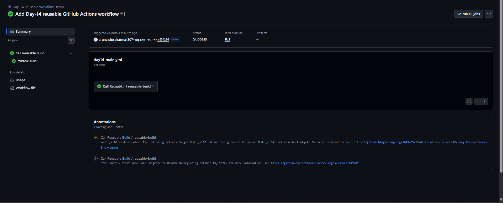
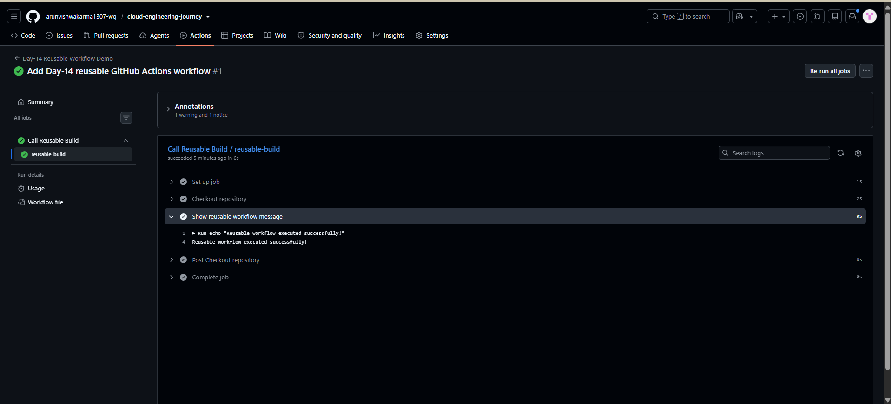

# Day-14: GitHub Actions Reusable Workflows

## Objective
Learn how to create a reusable GitHub Actions workflow and call it from another workflow.

## Tools Used
- GitHub Actions
- Git and GitHub
- YAML
- PowerShell

## What I Learned
- Created a reusable workflow using `workflow_call`.
- Created a main workflow to call the reusable workflow.
- Used `workflow_dispatch` for manual execution.
- Used `actions/checkout@v4` to check out the repository.
- Verified the reusable workflow execution through GitHub Actions logs.

## Implementation

### 1. Reusable Workflow
File: `.github/workflows/reusable-build.yml`

The reusable workflow uses `workflow_call` so another workflow can call it.

### 2. Main Workflow
File: `.github/workflows/day14-main.yml`

The main workflow calls the reusable workflow using:

```yaml
jobs:
  call-reusable-workflow:
    name: Call Reusable Build
    uses: ./.github/workflows/reusable-build.yml
```

The workflow supports manual execution through `workflow_dispatch` and push events matching its configured branch and path filters.

## Testing and Verification
- Pushed the workflow files to GitHub.
- GitHub Actions automatically started a run after the push.
- The `Call Reusable Build` job completed successfully.
- The `reusable-build` job completed successfully.
- The logs displayed: `Reusable workflow executed successfully!`

## Screenshots

### 1. Reusable Workflow Success


### 2. Reusable Workflow Logs


## Final Result
Successfully created, called, and tested a reusable GitHub Actions workflow using `workflow_call`.

## Key Takeaway
Reusable workflows help reduce repeated YAML code and make CI/CD pipelines easier to maintain.