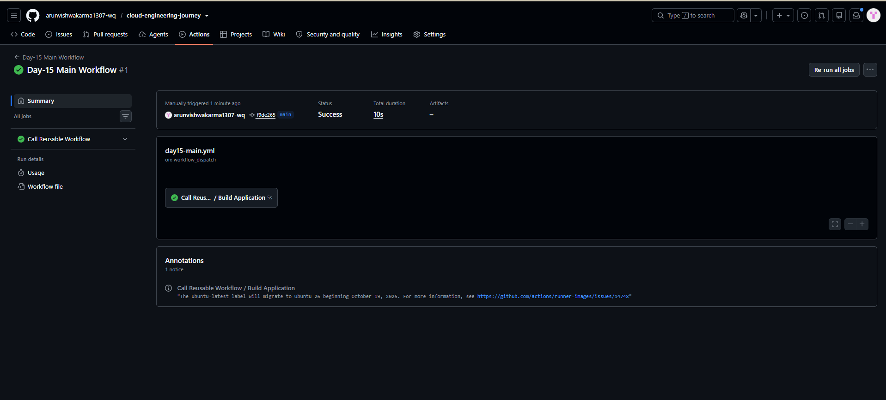
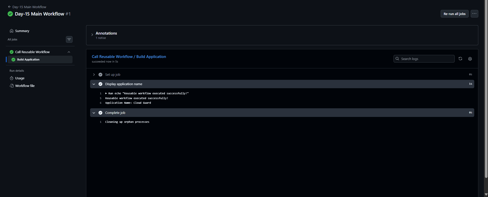

# Day-15: GitHub Actions Reusable Workflows with Inputs

## Objective
Learn how to pass input values from a main GitHub Actions workflow to a reusable workflow.

## Tools Used
- GitHub Actions
- Git and GitHub
- YAML
- PowerShell

## What I Learned
- Defined inputs in a reusable workflow using `workflow_call`.
- Used `type: string` to accept a text value.
- Passed an input value using the `with` keyword.
- Accessed the received value using `${{ inputs.app_name }}`.
- Manually triggered and tested the workflow through GitHub Actions.

## Implementation

### 1. Reusable Workflow
File: `.github/workflows/day15-reusable.yml`

The reusable workflow defines a required string input named `app_name`.

```yaml
on:
  workflow_call:
    inputs:
      app_name:
        description: "Name of the application"
        required: true
        type: string
```

The workflow prints the received application name in its logs.

### 2. Main Workflow
File: `.github/workflows/day15-main.yml`

The main workflow calls the reusable workflow and passes the application name:

```yaml
jobs:
  call-reusable-workflow:
    name: Call Reusable Workflow
    uses: ./.github/workflows/day15-reusable.yml
    with:
      app_name: "Cloud Guard"
```

## Testing and Verification
- Pushed both workflow files to GitHub.
- Opened **Day-15 Main Workflow** in the Actions tab.
- Manually triggered the workflow using the `main` branch.
- Confirmed that the workflow completed successfully.
- Verified the application name in the job logs.

Expected output:

```text
Reusable workflow executed successfully!
Application Name: Cloud Guard
```

## Screenshots

### 1. Workflow Success


### 2. Input Value Verification


## Final Result
Successfully passed the `Cloud Guard` input from the main workflow to the reusable workflow and verified the received value in GitHub Actions logs.

## Key Takeaway
Reusable workflow inputs make workflows more flexible by allowing the calling workflow to provide different values without duplicating the reusable workflow.