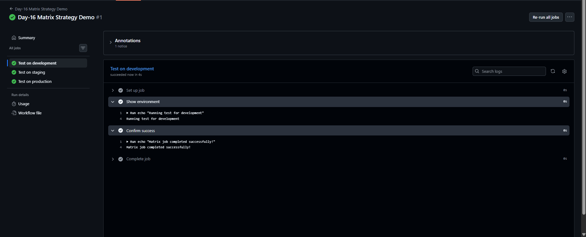
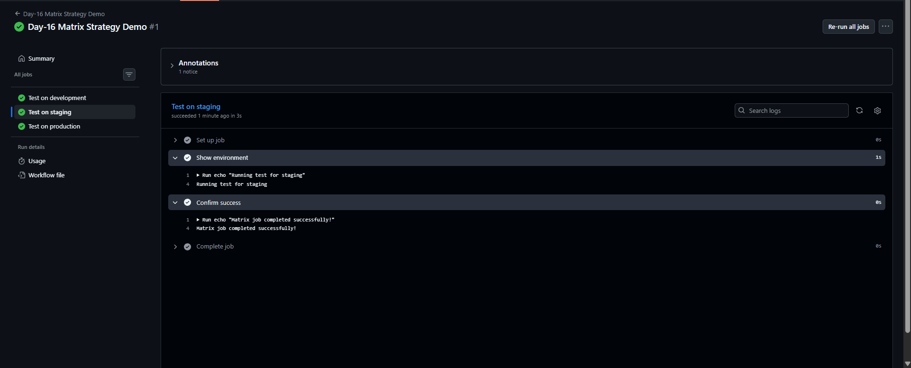
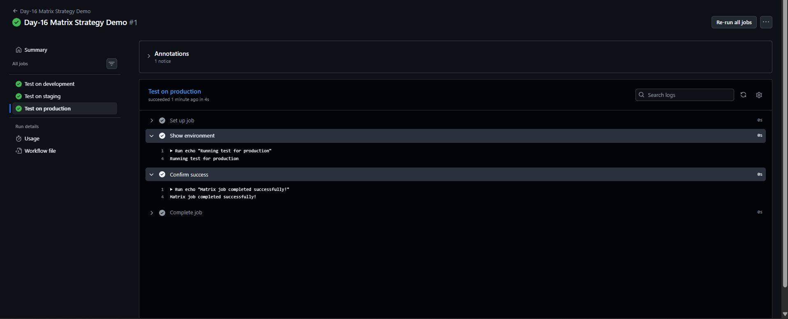

# Day-16: GitHub Actions Matrix Strategy

## Overview
In Day-16, I learned how to use the Matrix Strategy in GitHub Actions to run the same workflow job across multiple configurations automatically.

## Objectives
- Understand the purpose of `strategy.matrix`.
- Run the same job across multiple environments.
- Verify the result of each matrix job in GitHub Actions.

## Implementation
Created the workflow file:

`.github/workflows/day16-matrix.yml`

The workflow uses `workflow_dispatch` to allow manual execution and defines three matrix configurations:

- `development`
- `staging`
- `production`

GitHub Actions automatically creates a separate job for each environment.

## Workflow Results
The workflow was executed successfully in GitHub Actions.

- Development job: Success
- Staging job: Success
- Production job: Success

The logs displayed the environment name and the message:

`Matrix job completed successfully!`

This was a demonstration workflow. It did not deploy an application to any environment.

## Screenshots

### 1. Matrix Workflow Success

### 2. Staging Job Success

### 3. Production Job Success

## Key Learnings
- `strategy.matrix` runs a job with multiple configuration values.
- Each matrix configuration creates a separate job.
- GitHub Actions displays the status and logs of each job independently.
- Matrix Strategy helps reduce repeated workflow configuration.

## Workflow File
[View Day-16 Matrix Workflow](../../.github/workflows/day16-matrix.yml)