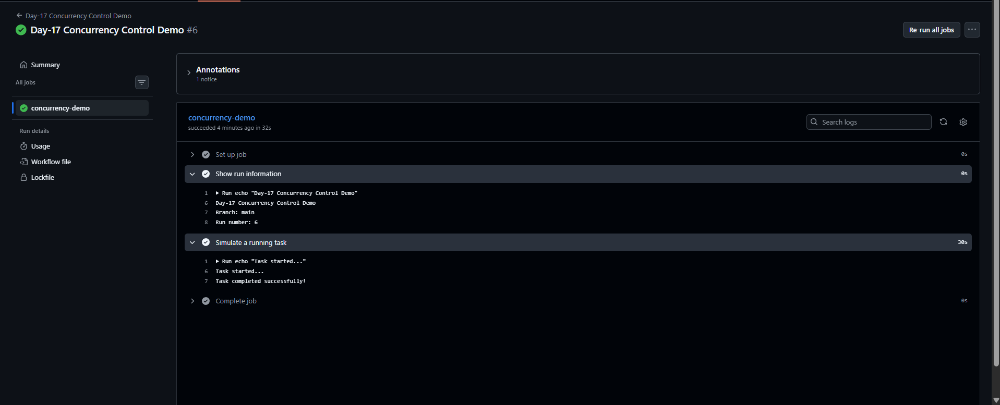
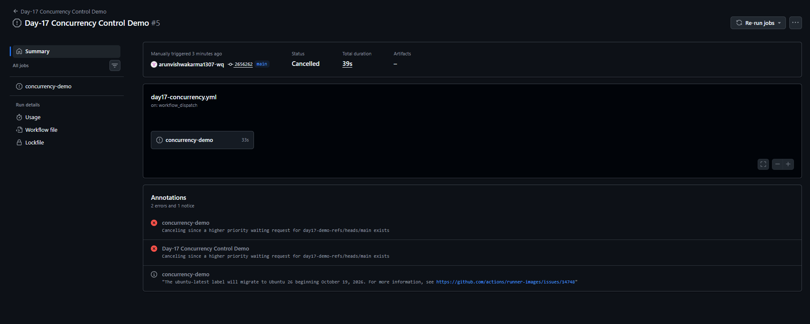
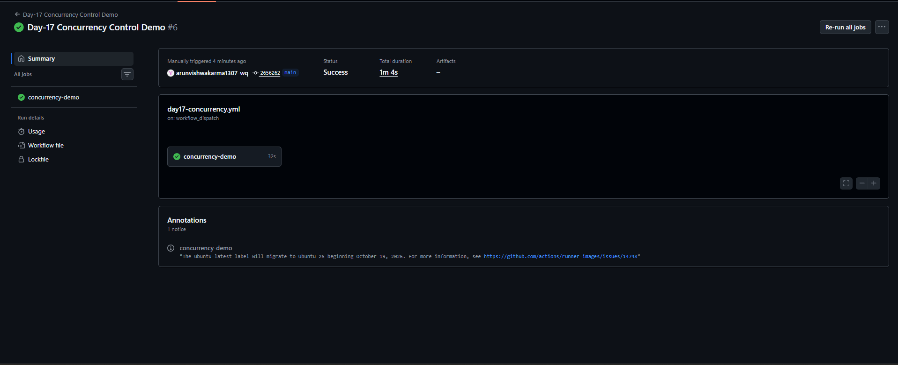

# Day-17: GitHub Actions Concurrency Control

## Overview

In Day-17, I learned how to control multiple workflow runs using concurrency in GitHub Actions.

Concurrency helps prevent unnecessary workflow runs from running at the same time when they belong to the same concurrency group.

## Objectives

- Understand GitHub Actions concurrency.
- Configure a concurrency group.
- Learn how `cancel-in-progress: true` works.
- Test workflow cancellation using GitHub Actions.

## Workflow File

File path:

`.github/workflows/day17-concurrency.yml`

## Implementation

The workflow uses `workflow_dispatch` to allow manual execution.

The concurrency configuration is:

```yaml
concurrency:
  group: day17-demo-${{ github.ref }}
  cancel-in-progress: true
```

### Explanation

- `concurrency`: Controls overlapping workflow runs.
- `group`: Groups runs by the current Git reference, such as the `main` branch.
- `cancel-in-progress: true`: Allows a new run to cancel an older in-progress run in the same concurrency group.

The workflow also prints the branch and run number, then simulates a task using a 30-second delay.

## Testing and Results

The workflow was tested manually through GitHub Actions.

- Successful workflow runs were verified.
- Run #5 showed the `Cancelled` status.
- Run #6 completed successfully.

This demonstrated the cancellation behavior for overlapping runs in the same concurrency group.

## Screenshots

### 1. Successful Workflow Run



### 2. Cancelled Workflow Run



### 3. Latest Workflow Run



## Key Learnings

- Concurrency groups help control overlapping workflow runs.
- `cancel-in-progress: true` can cancel an older in-progress run when a newer run starts in the same group.
- Workflow logs help verify run details and execution results.
- Cancellation can save CI resources when older runs are no longer needed.

## Important Note

This is a demonstration workflow. It does not deploy an application or modify any production environment.

## Workflow Source

[View Day-17 Concurrency Workflow](../../.github/workflows/day17-concurrency.yml)
