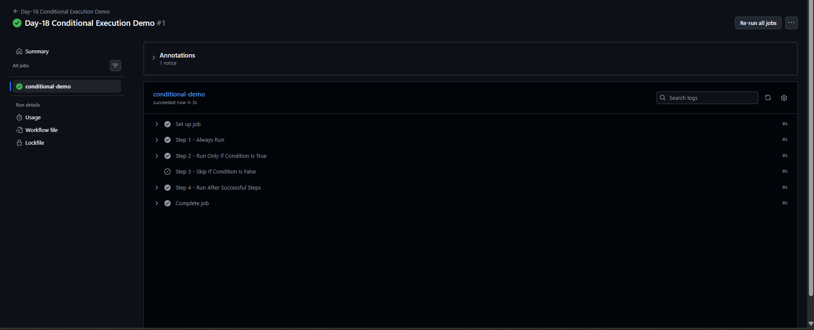
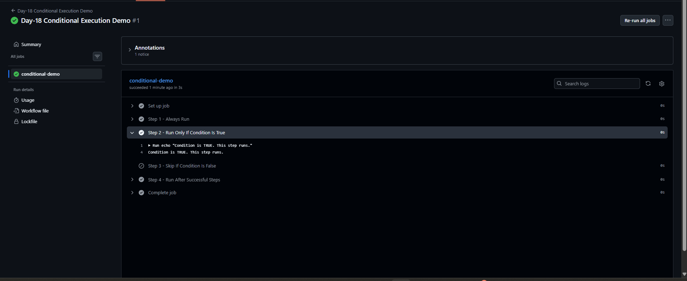

# Day-18: GitHub Actions Conditional Execution

## Objective
Learn how to control workflow step execution using conditions in GitHub Actions.

## Concepts Covered
- Conditional execution using `if`
- Running a step when a condition is `true`
- Skipping a step when a condition is `false`
- Using the `success()` function

## Workflow File
[day18-conditional-execution.yml](../../.github/workflows/day18-conditional-execution.yml)

## Implementation
Created a manually triggered GitHub Actions workflow using `workflow_dispatch`.

The workflow contains four steps:

1. **Step 1 - Always Run:** Executes a normal shell command.
2. **Step 2 - Condition Is True:** Uses `if: ${{ true }}` and runs successfully.
3. **Step 3 - Condition Is False:** Uses `if: ${{ false }}` and is skipped intentionally.
4. **Step 4 - Run After Successful Steps:** Uses `if: ${{ success() }}` and runs when previous steps succeed.

## Test Results
- Workflow execution completed successfully.
- Step 1 executed successfully.
- Step 2 executed successfully and printed the expected message.
- Step 3 was skipped as expected because its condition was `false`.
- Step 4 executed successfully.
- No workflow failure occurred.

## Screenshots

### 1. Complete Workflow Result

### 2. Condition True Output

## Key Learning
The `if` condition decides whether a step should run. A condition that evaluates to `true` allows the step to run, while `false` skips it.

The `success()` function checks whether previous steps have completed successfully.

## Conclusion
Successfully implemented and tested conditional execution in GitHub Actions. Learned how to run or skip workflow steps based on conditions.

**Status:** Completed
