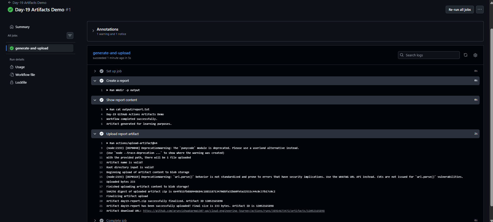
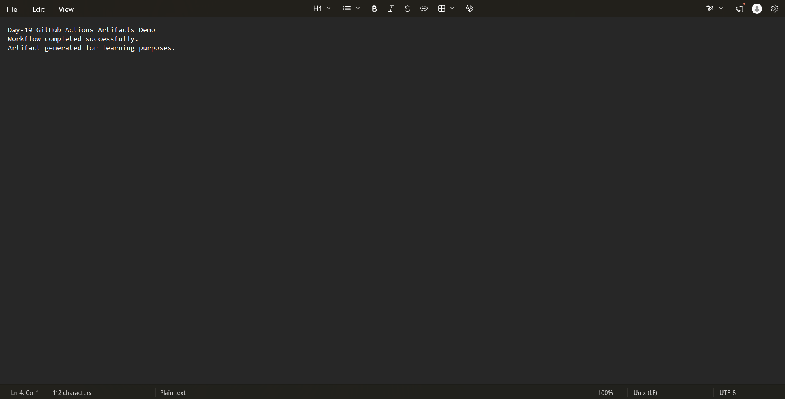

# Day-19: GitHub Actions Artifacts

## Objective
Learn how to generate a file in a GitHub Actions workflow, upload it as an artifact, and download it for verification.

## Concepts Covered
- Creating files inside a workflow
- Uploading artifacts with `actions/upload-artifact@v4`
- Finding artifacts in a workflow run
- Downloading and verifying artifact contents

## Workflow File
[day19-artifacts.yml](../../.github/workflows/day19-artifacts.yml)

## Implementation
Created a manually triggered GitHub Actions workflow using `workflow_dispatch`.

The workflow performs these steps:

1. **Create a report:** Creates `output/report.txt`.
2. **Show report content:** Prints the report contents in the workflow logs.
3. **Upload report artifact:** Uploads the report using `actions/upload-artifact@v4` with the name `day19-report`.

## Test Results
- Workflow run completed successfully.
- The report file was created successfully.
- The report contents appeared in the workflow logs.
- The `day19-report` artifact was uploaded successfully.
- Downloaded the artifact and verified the contents of `report.txt`.

Verified report content:

```text
Day-19 GitHub Actions Artifacts Demo
Workflow completed successfully.
Artifact generated for learning purposes.
```

## Screenshots

### 1. Artifact Upload Success


### 2. Downloaded Artifact Verification


## Key Learning
Artifacts allow files generated during a workflow run to be stored and downloaded later. They are useful for test reports, build outputs, and other workflow-generated files.

## Conclusion
Successfully created, uploaded, downloaded, and verified a GitHub Actions artifact.

**Status:** Completed
