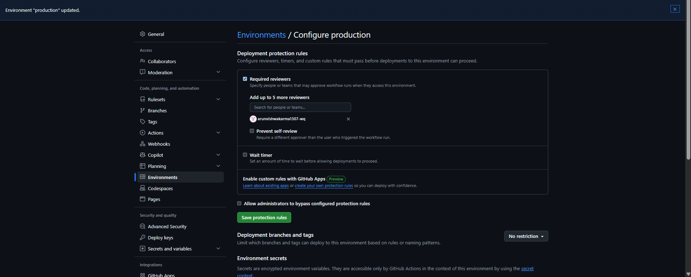
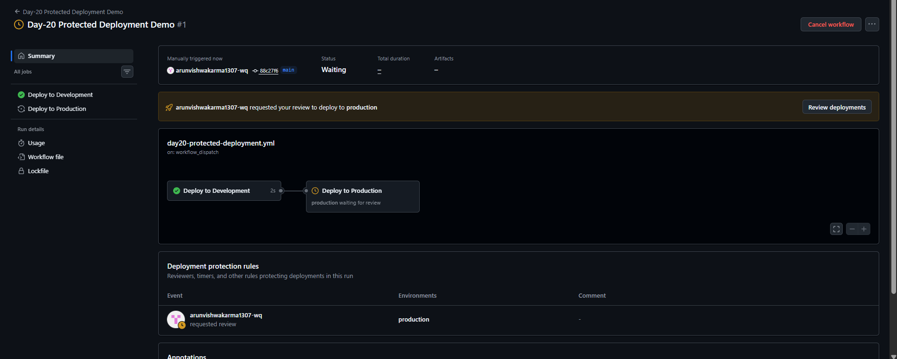
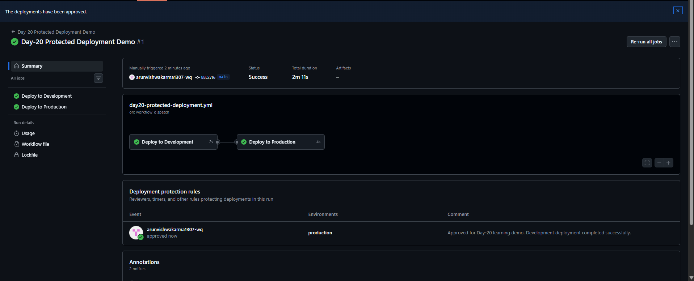

# Day-20: GitHub Actions Environments and Protected Deployments

## Objective
Learn how GitHub Actions environments control deployment flow and protect production deployments using required reviewers.

## What I Implemented
- Created `development` and `production` GitHub Environments.
- Configured required reviewers for the production environment.
- Created a GitHub Actions workflow triggered manually using `workflow_dispatch`.
- Used `needs: development` to make production wait for development.
- Tested the workflow and approved the production deployment.

## Workflow
1. The development job runs first.
2. The production job waits for development to succeed.
3. GitHub requests approval before allowing the production job to continue.
4. After approval, the production job completes successfully.

## Test Result
- Development job: Success
- Production job before approval: Waiting for review
- Production job after approval: Success
- Overall workflow: Success

## Important Note
This project simulates deployment using echo commands. It does not deploy a real application or server.

## Screenshots

### 1. Production Environment Protection

### 2. Production Waiting for Approval

### 3. Production Deployment Approved

## Skills Learned
- GitHub Actions environments
- Deployment protection rules
- Required reviewers
- Job dependencies using `needs`
- Manual workflow execution
- Production approval workflow

## Workflow File

[View Day-20 Protected Deployment Workflow](../../.github/workflows/day20-protected-deployment.yml)
