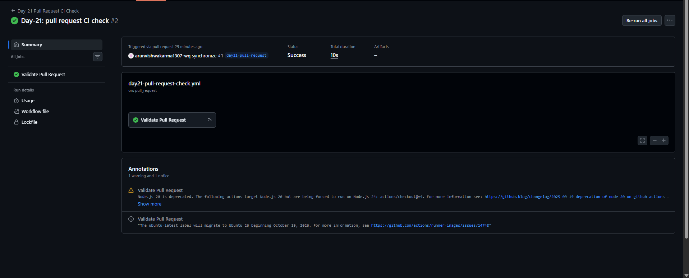
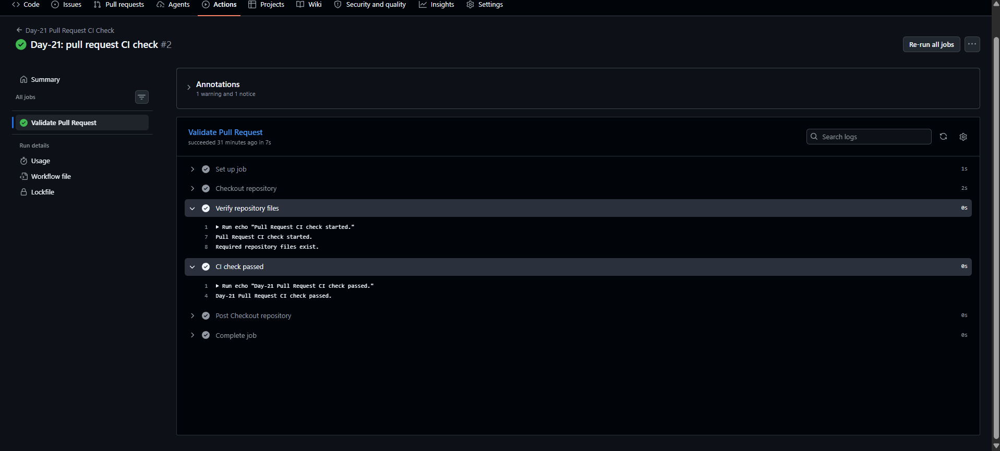
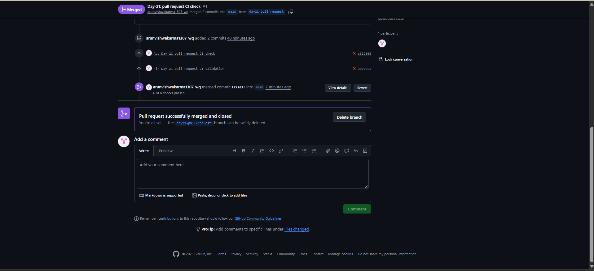

# Day-21: Pull Request CI Check

## Objective
Automatically run a GitHub Actions CI workflow whenever a Pull Request targets the `main` branch.

## What I Learned
- How the `pull_request` trigger works.
- How to validate repository files automatically.
- How to check workflow results in GitHub Actions.
- How to review and merge a Pull Request.

## Workflow Details
- **Workflow Name:** Day-21 Pull Request CI Check
- **Trigger:** Pull Request targeting `main`
- **Runner:** `ubuntu-latest`
- **Permission:** `contents: read`

## Workflow Code
Click the link below to view the complete workflow YAML file:

[View Day-21 Pull Request CI Workflow](../../.github/workflows/day21-pull-request-check.yml)

## How It Works
1. Runs when a Pull Request targets `main`.
2. Checks out the repository.
3. Verifies that the required repository files exist.
4. Prints a success message when validation passes.

## Screenshots

### 1. Pull Request CI Success

### 2. Validation Steps Passed

### 3. Pull Request Merged

## Practical Result
- The initial workflow failed because it checked for a root-level `README.md` that did not exist.
- The repository file paths were corrected.
- The updated Day-21 CI check passed.
- The Pull Request was successfully merged into `main`.

## Key Takeaway
Pull Request CI helps validate changes before they are merged into the main branch.

## Tools Used
- Git
- GitHub
- GitHub Actions
- YAML
- Visual Studio Code
