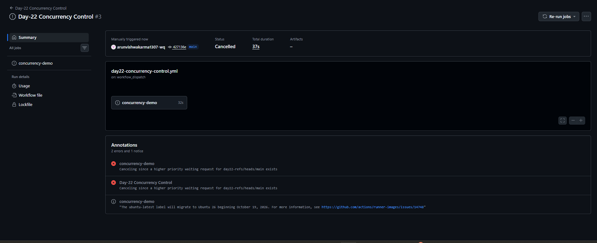
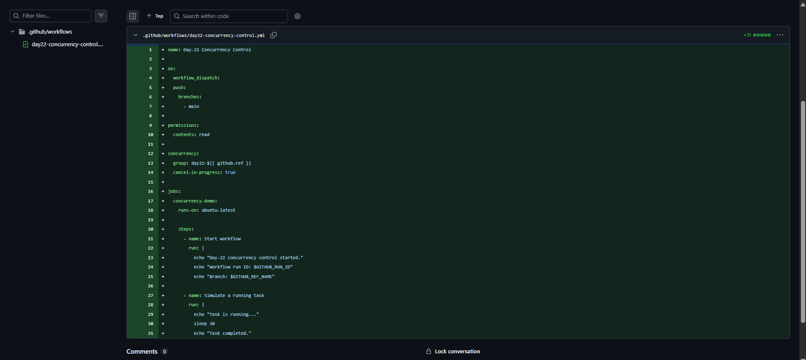
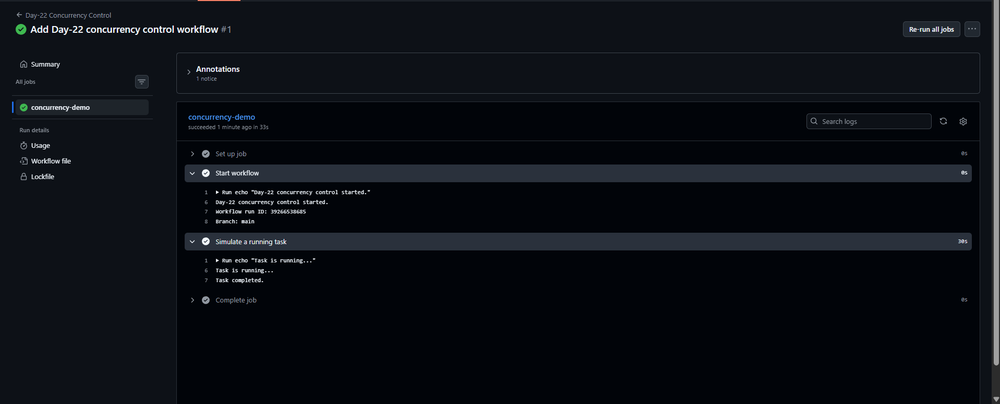

# Day-22: GitHub Actions Concurrency Control

## Overview
In Day-22, I learned how to control GitHub Actions workflow runs using concurrency settings.

This workflow demonstrates how a new run can cancel an existing run when both runs belong to the same concurrency group and `cancel-in-progress` is enabled.

## Objectives
- Understand GitHub Actions concurrency.
- Configure a concurrency group.
- Use `cancel-in-progress: true`.
- Test workflow cancellation behavior.
- Verify workflow execution in GitHub Actions.

## Workflow Configuration
**File:** `.github/workflows/day22-concurrency-control.yml`

```yaml
concurrency:
  group: day22-${{ github.ref }}
  cancel-in-progress: true
```

## How It Works
- **group:** Groups workflow runs by the Git reference, such as the `main` branch.
- **cancel-in-progress: true:** Allows a newer run in the same concurrency group to cancel an in-progress run.
- The workflow includes a 30-second simulated task to help test cancellation behavior.

## Practical Test
1. Triggered the workflow manually from GitHub Actions.
2. Started another run for the same branch while a run was active or waiting.
3. Observed a run marked as **Cancelled**.
4. Checked the cancellation annotation in the run details.

**Observed result:** GitHub Actions cancelled a run and displayed a message indicating that a higher-priority waiting request existed for the same concurrency group.

## Screenshots

### 1. Workflow Success


### 2. Concurrency Settings


### 3. Concurrency Cancellation


## Key Learnings
- Concurrency helps manage overlapping workflow runs.
- A concurrency group defines which runs compete with each other.
- `cancel-in-progress: true` enables cancellation of an older in-progress run when a newer run takes priority.
- Workflow run details help verify cancellation behavior.

## Workflow File
[View Day-22 Concurrency Control Workflow](../../.github/workflows/day22-concurrency-control.yml)

## Status
Completed — workflow execution and concurrency cancellation behavior tested in GitHub Actions.
