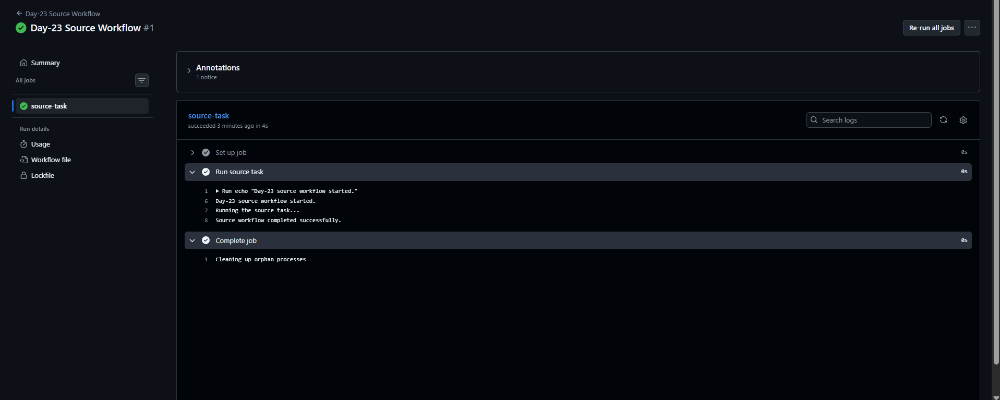
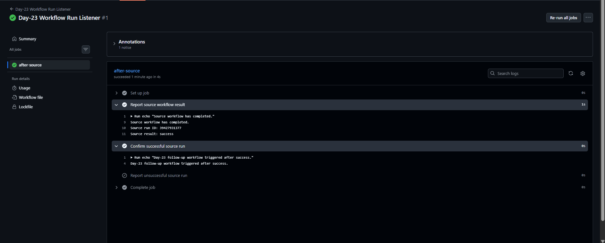

# Day-23: GitHub Actions `workflow_run` Event

## Objective
Learn how to automatically trigger a second GitHub Actions workflow after another workflow completes.

## Concepts Covered
- `workflow_dispatch`: Manually start a workflow.
- `workflow_run`: Trigger a workflow after another workflow completes.
- `github.event.workflow_run.conclusion`: Read the source workflow result.
- Conditional execution using `if`.
- GitHub Actions workflow permissions.

## Workflow Files Created

1. [Source Workflow](../../.github/workflows/day23-source.yml)
2. [Workflow Run Listener](../../.github/workflows/day23-workflow-run.yml)

## How It Works

1. The source workflow starts manually using `workflow_dispatch`.
2. It runs a simple task and completes.
3. The listener detects when the source workflow completes.
4. The listener prints the source run ID and result.
5. A conditional step prints a success or unsuccessful-result message.

## Screenshots

### 1. Source Workflow — Success

### 2. Workflow Run Listener — Success

## Verification Results

- Both YAML files passed local YAML parsing.
- The source workflow ran successfully on GitHub Actions.
- The listener triggered automatically after the source workflow completed.
- The listener workflow completed successfully.
- Logs displayed `Source result: success`.
- The success confirmation step ran.
- The unsuccessful-result step was skipped.

## Key Learning

The `workflow_run` event connects separate GitHub Actions workflows. It is useful for running a follow-up task after another workflow finishes.

## Security Note

A workflow triggered by `workflow_run` may have access to secrets or write permissions depending on its configuration. Avoid using it carelessly with untrusted code or artifacts.

## Limitation

This practical demonstrates workflow triggering and result reporting. It does not perform a real deployment or modify production resources.

## Status

**Completed and tested successfully.**