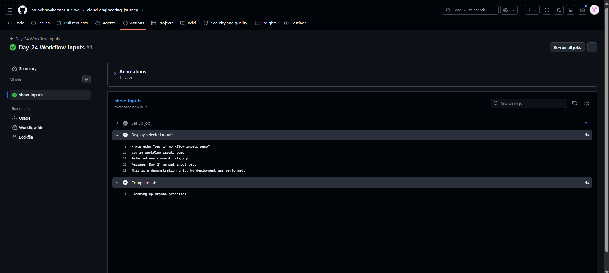
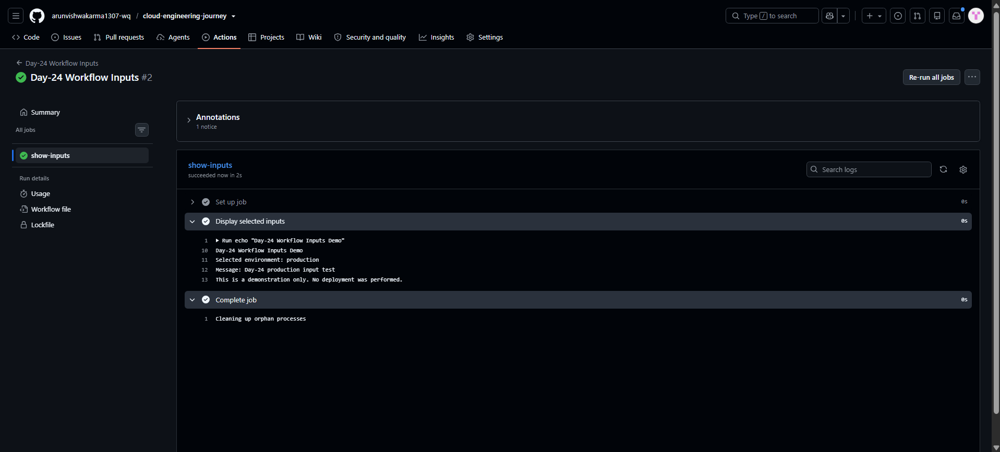

# Day-24: GitHub Actions Workflow Inputs

## Objective

Learn how to accept manual inputs when running a GitHub Actions workflow and use those inputs inside workflow steps.

## Concepts Covered

- `workflow_dispatch` for manually triggering a workflow.
- `type: choice` for selecting an environment from a dropdown.
- `type: string` for accepting a custom message.
- Using the `inputs` context to access user-provided values.
- Passing inputs to environment variables.
- Verifying workflow execution through GitHub Actions logs.

## Workflow File

[Day-24 Workflow Inputs](../../.github/workflows/day24-workflow-inputs.yml)

## How It Works

1. The user manually starts the workflow from GitHub Actions.
2. The workflow asks the user to select a target environment.
3. The user enters a custom message.
4. GitHub Actions passes the submitted values to the job.
5. The workflow prints the selected environment and message in its logs.
6. The workflow confirms that no real deployment was performed.

## Test Results

### Test 1: Staging Environment

- Selected environment: `staging`
- Message: `Day-24 manual input test`
- Result: Successful

### Test 2: Production Environment

- Selected environment: `production`
- Message: `Day-24 production input test`
- Result: Successful

## Screenshots

### 1. Staging Input Test

### 2. Production Input Test

## Verification

- YAML syntax check passed locally.
- The workflow was pushed to GitHub.
- The staging input test completed successfully.
- The production input test completed successfully.
- Both custom messages were displayed in the workflow logs.
- No real deployment was performed.

## Key Learning

The `workflow_dispatch` event supports manual inputs, allowing a workflow to accept user choices and custom values at runtime.

## Security Note

Inputs should be validated before being used in shell commands or deployment operations. Never pass untrusted input directly into a shell command. Secrets must not be printed in workflow logs.

## Limitation

This practical demonstrates manual workflow inputs only. It does not deploy an application or change production resources.

## Status

**Completed and tested successfully.**
