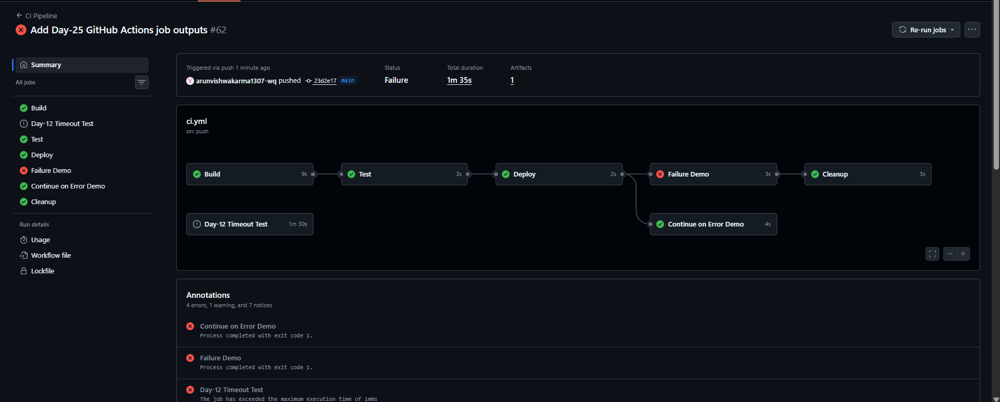
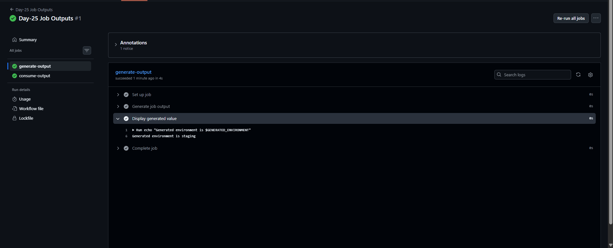
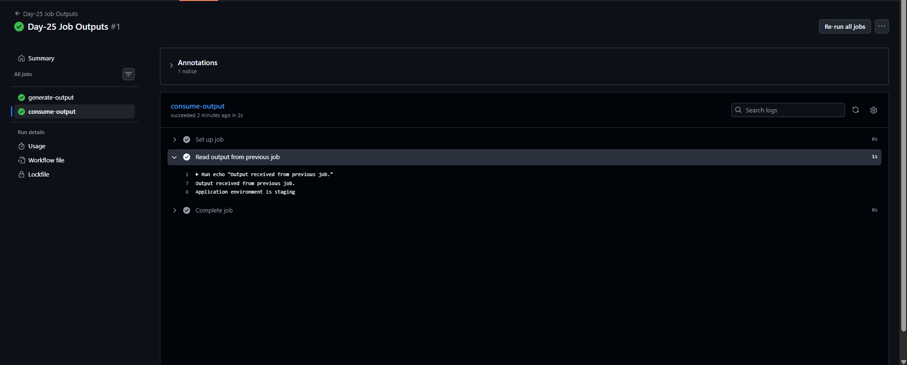

# Day-25: GitHub Actions Job Outputs

## Overview
In this practical, I learned how to pass output values from one job to another in GitHub Actions. The first job generates an environment value, and the second job receives and uses that value.

## Objectives
- Generate an output using `GITHUB_OUTPUT`.
- Define a job output using the `outputs` keyword.
- Use `needs` to access output from a previous job.
- Verify that the output value is passed successfully between jobs.

## Workflow Details

### 1. generate-output
- Generates the value `staging`.
- Saves it as a step output using `GITHUB_OUTPUT`.
- Exposes it as a job output.

### 2. consume-output
- Waits for `generate-output` using `needs`.
- Reads the output from the first job.
- Displays the received environment value.

## Expected Output

    Generated environment is staging
    Output received from previous job.
    Application environment is staging

## Screenshots

### 1. Workflow Run Overview

### 2. Generate Output Job

### 3. Consume Output Job

## Result
The workflow ran successfully, and the `staging` value was passed from the first job to the second job.

## What I Learned
I learned how GitHub Actions uses step outputs, job outputs, and the `needs` keyword to share data between jobs.

**Note:** This practical demonstrates output sharing only. It does not perform an actual application deployment.