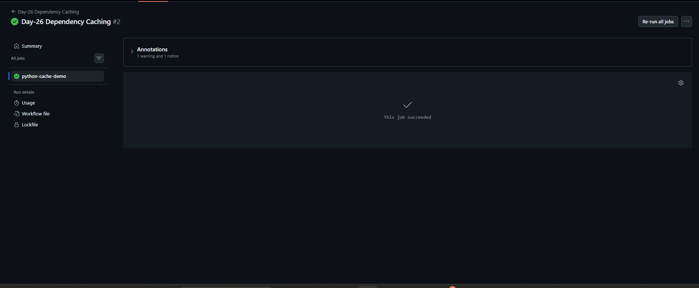
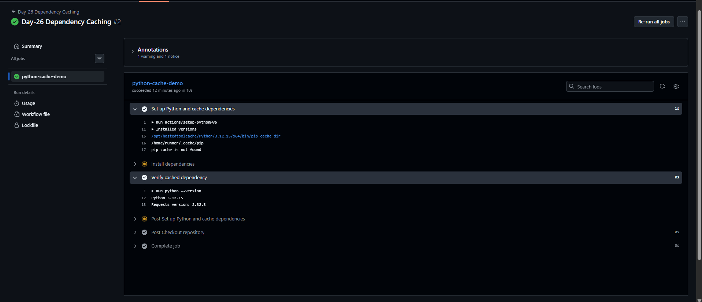

# Day-26: GitHub Actions Dependency Caching

## 📌 Overview

In this practical, I learned how to configure dependency caching in GitHub Actions using Python. Caching can help reuse downloaded packages between workflow runs and reduce installation time.

## 🎯 Objectives

- Configure Python using actions/setup-python.
- Enable pip dependency caching.
- Define dependencies using requirements.txt.
- Install and verify the Python requests package.
- Understand cache hits and cache misses.

## 🛠️ Tools and Technologies

- GitHub Actions
- Python 3.12
- pip
- actions/setup-python
- requests

## ⚙️ Implementation

1. Created the Day-26 dependency caching workflow.
2. Created a requirements.txt file for the demo.
3. Added requests==2.32.3 as the dependency.
4. Enabled pip caching in actions/setup-python.
5. Installed the dependency and verified its version.

## 📸 Screenshots

### 1. Workflow Successful

### 2. Dependency Cache Run Logs

## 🔗 Workflow Source Code

[View Day-26 Dependency Caching Workflow](https://github.com/arunvishwakarma1307-wq/cloud-engineering-journey/blob/main/.github/workflows/day26-dependency-cache.yml)

[View Day-26 Requirements File](https://github.com/arunvishwakarma1307-wq/cloud-engineering-journey/blob/main/CI-CD/Day-26/requirements.txt)

## ✅ Result

The GitHub Actions workflow completed successfully, and the installed Requests version was verified as 2.32.3.

The captured logs showed "pip cache is not found". Therefore, a cache hit has not yet been confirmed.

## 📚 Key Learnings

- Dependency caching can reduce repeated package downloads.
- cache: pip enables pip caching with actions/setup-python.
- cache-dependency-path specifies the requirements file used for the cache key.
- Workflow success does not automatically mean the cache was hit.