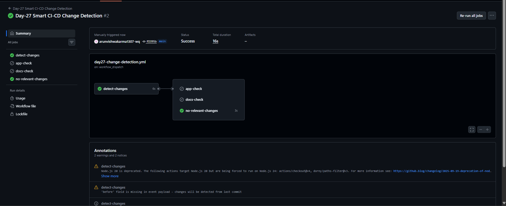

# Day-27: Smart CI/CD Pipeline with Change Detection

## 📌 Overview

In this practical, I created a GitHub Actions workflow that detects changes in selected repository folders and runs jobs based on the detected changes.

This approach helps avoid running unnecessary jobs when the changed files do not match the required conditions.

## 🎯 Objectives

- Detect changes in selected repository paths.
- Use conditional jobs in GitHub Actions.
- Run jobs only when their conditions are met.
- Understand successful and skipped jobs.
- Learn how path filters control workflow execution.

## 🛠️ Tools and Technologies

- GitHub Actions
- YAML
- Git
- GitHub Repository

## ⚙️ Implementation

1. Created the `day27-change-detection.yml` workflow.
2. Configured manual execution using `workflow_dispatch`.
3. Configured path filters for Kubernetes, Terraform, and documentation files.
4. Used `dorny/paths-filter@v3` to detect file changes.
5. Added conditional jobs for application-related and documentation-related changes.
6. Added a fallback job for cases where no relevant changes are detected.
7. Manually ran the workflow and checked the job results.

## 🔍 How It Works

- **detect-changes:** Checks whether files match the configured path filters.
- **app-check:** Runs when changes are detected in the Kubernetes or Terraform folders.
- **docs-check:** Runs when documentation changes are detected.
- **no-relevant-changes:** Runs when neither application-related nor documentation-related changes are detected.

The application and documentation jobs contain demonstration commands. They do not run actual Kubernetes, Terraform, or documentation tests.

## 📸 Screenshot

### Workflow Execution and Job Results

## 🔗 Workflow Source Code

[View Day-27 Change Detection Workflow](https://github.com/arunvishwakarma1307-wq/cloud-engineering-journey/blob/main/.github/workflows/day27-change-detection.yml)

## ✅ Result

The workflow completed successfully during manual execution.

The `detect-changes` and `no-relevant-changes` jobs succeeded, while `app-check` and `docs-check` were skipped because no matching changes were detected.

## 📚 Key Learnings

- Path filters identify changes in selected files and folders.
- Conditional jobs run only when their specified conditions are satisfied.
- Skipped jobs can be an expected result rather than a failure.
- Change detection can help reduce unnecessary CI/CD work.
- A successful demonstration workflow does not automatically mean application tests have been performed.