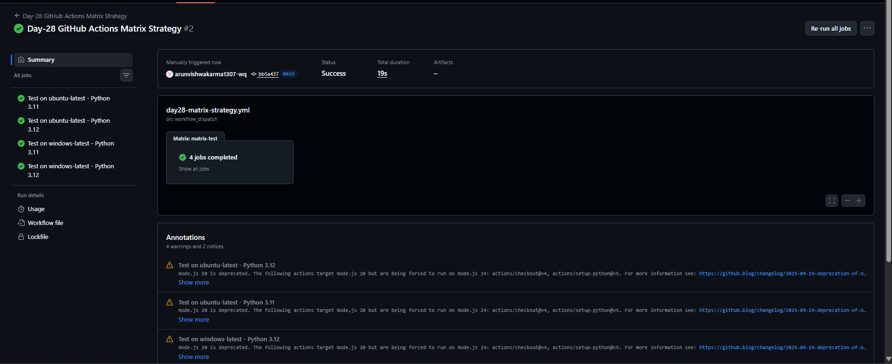
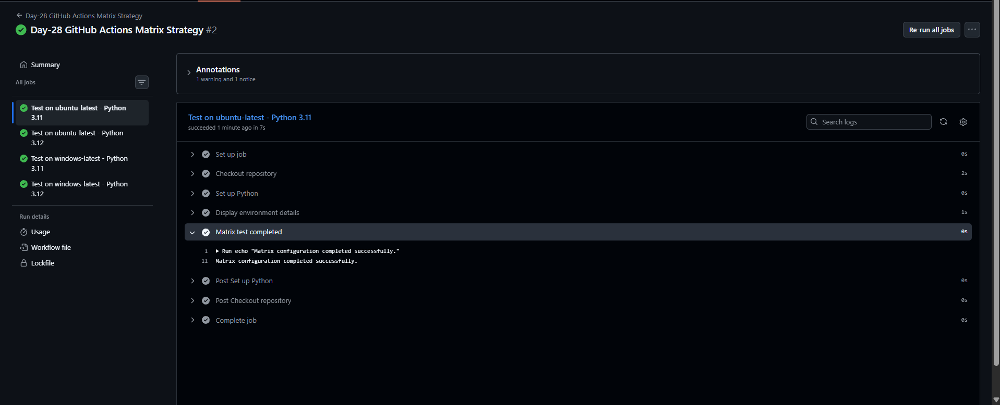

# Day-28: GitHub Actions Matrix Strategy

## 📌 Overview

In this practical, I implemented a GitHub Actions Matrix Strategy to run the same workflow across multiple operating systems and Python versions.

Instead of creating separate jobs for every configuration, I used a matrix to automatically generate four job combinations.

## 🎯 Objectives

- Understand GitHub Actions Matrix Strategy.
- Run jobs on multiple operating systems.
- Test multiple Python versions using one workflow.
- Understand matrix configurations and parallel job execution.
- Verify workflow execution through GitHub Actions logs.

## 🛠️ Tools and Technologies

- GitHub Actions
- Git
- GitHub Repository
- YAML
- Python 3.11
- Python 3.12
- Ubuntu
- Windows

## ⚙️ Implementation

1. Created the `day28-matrix-strategy.yml` workflow file.
2. Configured manual execution using `workflow_dispatch`.
3. Configured the matrix with Ubuntu and Windows runners.
4. Added Python versions 3.11 and 3.12.
5. Used `actions/checkout@v4` to check out the repository.
6. Used `actions/setup-python@v5` to configure the Python version.
7. Added commands to display the Python version and operating system.
8. Manually triggered the workflow from GitHub Actions.
9. Verified that all four matrix jobs completed successfully.

## 🔄 Matrix Configuration

| Operating System | Python Version |
|---|---|
| Ubuntu | 3.11 |
| Ubuntu | 3.12 |
| Windows | 3.11 |
| Windows | 3.12 |

The matrix automatically generates four job combinations from two operating systems and two Python versions.

## 🔍 How It Works

- **Matrix:** Creates multiple job combinations from the configured values.
- **runs-on:** Selects the operating system runner.
- **python-version:** Specifies the Python version for each job.
- **fail-fast: false:** Allows other matrix jobs to continue if one job fails.
- **workflow_dispatch:** Allows manual execution from the GitHub Actions interface.

## 📸 Screenshots

### 1. Matrix Workflow Execution

### 2. Python Version and Operating System Output

## 🔗 Workflow Source Code

[View Day-28 Matrix Strategy Workflow](https://github.com/arunvishwakarma1307-wq/cloud-engineering-journey/blob/main/.github/workflows/day28-matrix-strategy.yml)

## ✅ Result

The GitHub Actions workflow completed successfully, and all four matrix jobs passed.

Python versions 3.11 and 3.12 were configured on both Ubuntu and Windows runners. The workflow displayed the Python version and operating system for each configuration.

GitHub Actions also displayed Node.js deprecation warnings for the action runtime. These warnings did not prevent the four jobs from succeeding.

## 📚 Key Learnings

- Matrix Strategy reduces the need to write repetitive jobs.
- A single workflow can test multiple operating systems and software versions.
- Each matrix combination runs as a separate job.
- GitHub Actions logs help verify the environment used by each job.
- Successful workflow execution and runtime warnings can occur together.