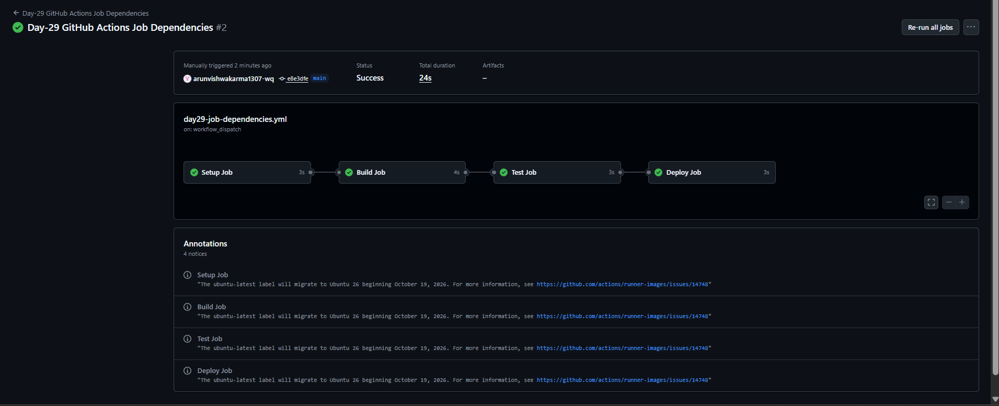
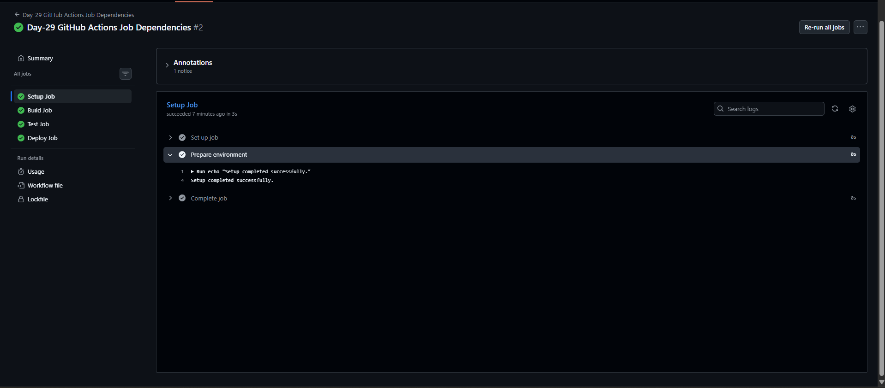

# Day-29: GitHub Actions Job Dependencies

## Overview
This project demonstrates how GitHub Actions controls the execution order of jobs using the `needs` keyword.

## Objective
To understand how jobs depend on one another and run in a specific sequence in a CI/CD workflow.

## Tools Used
- GitHub Actions
- YAML
- Git and GitHub
- PowerShell

## Workflow Code

File: `.github/workflows/day29-job-dependencies.yml`

```yaml
name: Day-29 GitHub Actions Job Dependencies

on:
  workflow_dispatch:
  push:
    paths:
      - "CI-CD/Day-29/**"
      - ".github/workflows/day29-job-dependencies.yml"

permissions:
  contents: read

jobs:
  setup:
    name: Setup Job
    runs-on: ubuntu-latest
    steps:
      - name: Prepare environment
        run: echo "Setup completed successfully."

  build:
    name: Build Job
    runs-on: ubuntu-latest
    needs: setup
    steps:
      - name: Build demonstration
        run: echo "Build completed after setup."

  test:
    name: Test Job
    runs-on: ubuntu-latest
    needs: build
    steps:
      - name: Test demonstration
        run: echo "Tests completed after build."

  deploy:
    name: Deploy Job
    runs-on: ubuntu-latest
    needs: test
    steps:
      - name: Deployment demonstration
        run: echo "Deployment demonstration completed after tests."
```

## Understanding the Code

- `workflow_dispatch` allows the workflow to be started manually.
- `push.paths` runs the workflow when matching files are changed.
- `permissions: contents: read` gives the workflow read-only repository content access.
- `runs-on: ubuntu-latest` selects an Ubuntu runner.
- `needs: setup` makes the Build Job wait for Setup.
- `needs: build` makes the Test Job wait for Build.
- `needs: test` makes the Deploy Job wait for Test.
- `run` executes the demonstration command in each job.

## Job Execution Order

`Setup → Build → Test → Deploy`

The `needs` keyword defines the dependency chain. If a required job fails, its dependent jobs are skipped by default.

## Testing and Results

The workflow was manually triggered from GitHub Actions.

- Setup Job: Success
- Build Job: Success
- Test Job: Success
- Deploy Job: Success

All four jobs completed successfully in the expected order.

## Screenshots

### 1. Successful Workflow


### 2. Setup Job Logs


## What I Learned

- How to define job dependencies with `needs`.
- How to control the execution order of CI/CD jobs.
- How to manually run and verify a GitHub Actions workflow.
- Why dependent jobs should wait for prerequisite jobs.

## Note
This is a learning demonstration. The Build, Test, and Deploy jobs use `echo` commands; they do not build an actual application, run real application tests, or deploy a service.

## Conclusion
This practical helped me understand how GitHub Actions job dependencies control execution order and organize a multi-stage CI/CD workflow.
