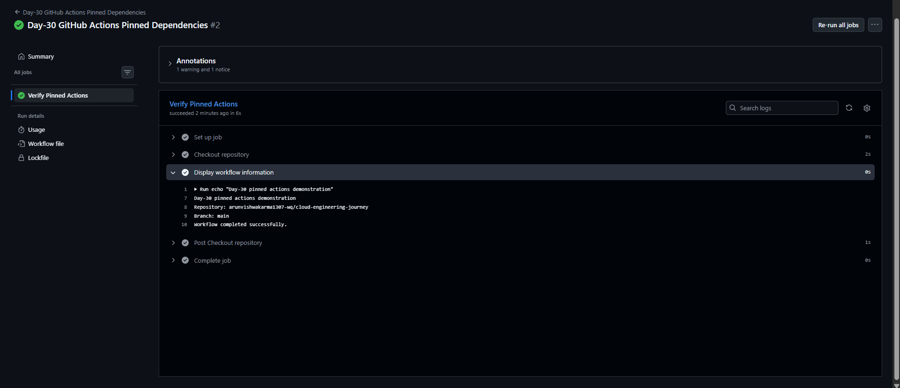
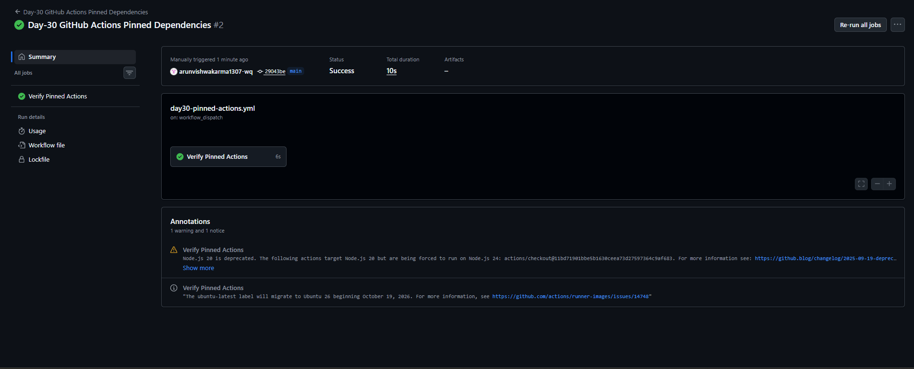

# Day-30: GitHub Actions — Pin Actions to Commit SHAs

## Overview
This practical demonstrates how to pin a GitHub Action to a specific commit SHA instead of using a version tag. Pinning helps ensure that the workflow uses a fixed revision of an action.

## Objective
- Understand action pinning using a full commit SHA.
- Learn how to reference a fixed revision of a GitHub Action.
- Run and verify the workflow using GitHub Actions.

## Tools Used
- GitHub Actions
- Git and GitHub
- YAML
- PowerShell

## Workflow File

**File:** `.github/workflows/day30-pinned-actions.yml`

[View the complete Day-30 workflow file on GitHub](https://github.com/arunvishwakarma1307-wq/cloud-engineering-journey/blob/main/.github/workflows/day30-pinned-actions.yml)

## Workflow Code

```yaml
name: Day-30 GitHub Actions Pinned Dependencies

on:
  workflow_dispatch:
  push:
    paths:
      - "CI-CD/Day-30/**"
      - ".github/workflows/day30-pinned-actions.yml"

permissions:
  contents: read

jobs:
  pinned-actions-demo:
    name: Verify Pinned Actions
    runs-on: ubuntu-latest

    steps:
      - name: Checkout repository
        uses: actions/checkout@11bd71901bbe5b1630ceea73d27597364c9af683

      - name: Display workflow information
        run: |
          echo "Day-30 pinned actions demonstration"
          echo "Repository: $GITHUB_REPOSITORY"
          echo "Branch: $GITHUB_REF_NAME"
          echo "Workflow completed successfully."
```

## Understanding the Workflow

- `workflow_dispatch` allows manual workflow execution.
- `push.paths` triggers the workflow when matching files change.
- `permissions: contents: read` limits the workflow's repository content permission to read access.
- `runs-on: ubuntu-latest` selects an Ubuntu runner.
- `uses: actions/checkout@...` references the checkout action using a full commit SHA.
- The final step displays repository and branch information.

## Why Pin Actions to Commit SHAs?

- A full commit SHA identifies a specific revision of an action.
- It avoids relying on a movable version tag.
- It improves dependency consistency and helps protect the workflow's supply chain.
- The SHA should be verified against the official action repository before use.

## Testing and Results

The workflow was manually triggered from the GitHub Actions tab.

- Workflow: Day-30 GitHub Actions Pinned Dependencies
- Job: Verify Pinned Actions
- Result: Success
- Checkout repository: Completed
- Display workflow information: Completed

The workflow completed successfully. GitHub displayed a Node.js 20 deprecation warning for the pinned checkout action; this warning did not cause the run to fail.

## Screenshots

### 1. Workflow Job Logs


### 2. Workflow Success Summary


## Key Learnings

- How to pin a GitHub Action to a full commit SHA.
- Why fixed action revisions are useful for dependency security.
- How to run and verify a GitHub Actions workflow.
- How to identify warnings separately from workflow failures.

## Conclusion

This practical helped me understand how GitHub Actions can use a fixed commit SHA for an action dependency and how to verify the workflow execution in GitHub Actions.

## Important Note

This is a learning demonstration. The workflow checks out the repository and prints environment information; it does not build, test, or deploy an actual application.
