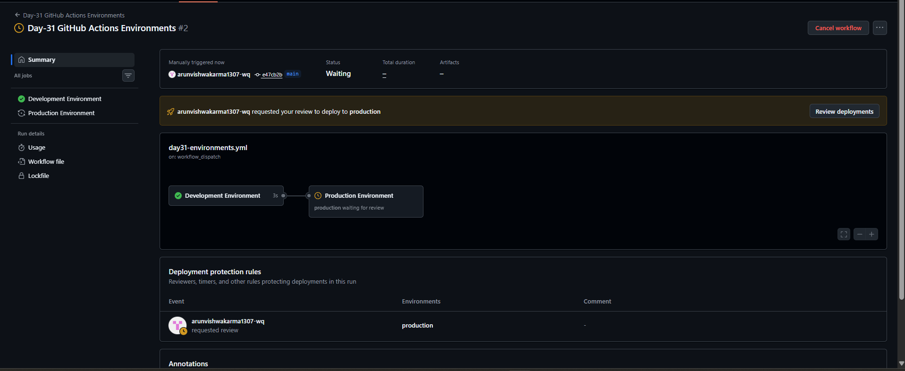
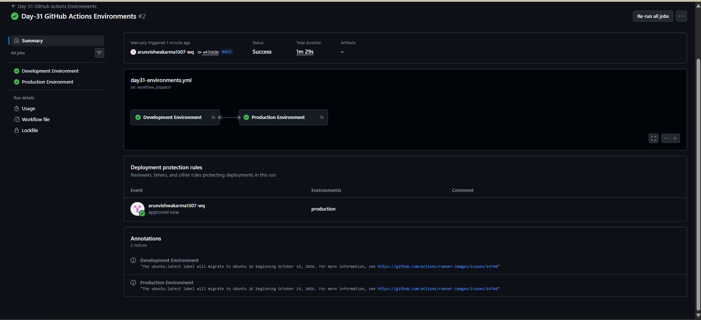

# Day-31: GitHub Actions Environments

## Overview
This practical demonstrates how GitHub Actions environments can separate development and production jobs and require approval before a production job continues.

## Objective
- Understand GitHub Actions environments.
- Connect workflow jobs to `development` and `production` environments.
- Learn how production approval can pause a workflow.
- Verify the workflow before and after approval.

## Tools Used
- GitHub Actions
- Git and GitHub
- YAML
- PowerShell

## Workflow File

**File:** `.github/workflows/day31-environments.yml`

[View the Day-31 workflow file on GitHub](https://github.com/arunvishwakarma1307-wq/cloud-engineering-journey/blob/main/.github/workflows/day31-environments.yml)

## Workflow Code

```yaml
name: Day-31 GitHub Actions Environments

on:
  workflow_dispatch:
  push:
    paths:
      - "CI-CD/Day-31/**"
      - ".github/workflows/day31-environments.yml"

permissions:
  contents: read

jobs:
  development:
    name: Development Environment
    runs-on: ubuntu-latest
    environment: development
    steps:
      - name: Development deployment demo
        run: |
          echo "Development environment selected."
          echo "Application is ready for development testing."

  production:
    name: Production Environment
    runs-on: ubuntu-latest
    needs: development
    environment: production
    steps:
      - name: Production deployment demo
        run: |
          echo "Production environment selected."
          echo "Production deployment demonstration completed."
```

## Understanding the Workflow

- `workflow_dispatch` allows manual workflow execution.
- `push.paths` triggers the workflow when matching files change.
- `permissions: contents: read` gives the workflow read-only repository content access.
- `environment: development` connects the Development job to the `development` environment.
- `environment: production` connects the Production job to the `production` environment.
- `needs: development` makes Production wait for Development to succeed.
- `run` executes the demonstration commands.

## How Production Approval Worked

1. The Development Environment job completed successfully.
2. The Production Environment job paused and displayed **Waiting for review**.
3. I opened the deployment review option and approved the production deployment.
4. The Production Environment job continued and completed successfully.

The approval was handled through GitHub's environment protection settings.

## Testing and Results

The workflow was manually triggered from GitHub Actions.

- Development Environment: Success
- Production Environment before approval: Waiting for review
- Production Environment after approval: Success
- Overall workflow result: Success

## Screenshots

### 1. Production Waiting for Approval


### 2. Production Approved and Workflow Successful


## What I Learned

- How to associate jobs with GitHub Actions environments.
- How `needs` controls job execution order.
- How environment protection rules can require approval before a production job continues.
- How to verify a workflow before and after approval.

## Important Note
This is a learning demonstration. The jobs use `echo` commands and do not deploy an actual application. The production approval gate was observed during the workflow run.

## Conclusion
This practical helped me understand how GitHub Actions environments separate deployment stages and how production approval can control when a job proceeds.
