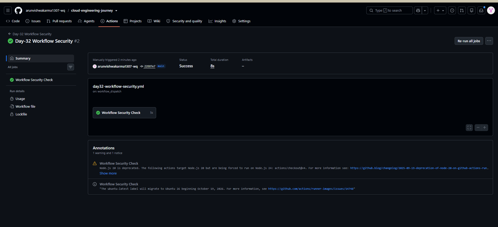

# Day-32: GitHub Actions Workflow Security

## Objective

The objective of this practical is to understand how to secure GitHub Actions workflows by controlling repository permissions.

## What I Learned

- Why workflow security is important.
- What `GITHUB_TOKEN` is used for.
- How to apply minimum required permissions.
- How to use read-only repository access.
- Why unnecessary write permissions should be avoided.

## Practical Implementation

Created a GitHub Actions workflow that uses read-only repository permissions.

### Workflow File

[View Day-32 Workflow](../../.github/workflows/day32-workflow-security.yml)

### Workflow Code

```yaml
name: Day-32 Workflow Security

on:
  workflow_dispatch:
  push:
    paths:
      - "CI-CD/Day-32/**"
      - ".github/workflows/day32-workflow-security.yml"

permissions:
  contents: read

jobs:
  security-check:
    name: Workflow Security Check
    runs-on: ubuntu-latest

    permissions:
      contents: read

    steps:
      - name: Checkout repository
        uses: actions/checkout@v4

      - name: Display security information
        run: |
          echo "Day-32 Workflow Security"
          echo "Repository access is read-only."
          echo "No unnecessary write permissions are granted."
```

## Key Concepts

### 1. GITHUB_TOKEN

GitHub automatically provides a token to workflows for accessing repository resources.

### 2. Minimum Permissions

A workflow should receive only the permissions it actually needs.

### 3. Read-Only Access

`contents: read` allows the workflow to read repository contents without granting repository content write access.

### 4. Security Benefit

Limiting permissions helps reduce the impact if a workflow or one of its actions is compromised.

## Practical Result

The Day-32 GitHub Actions workflow was executed successfully.

## Screenshot



## Conclusion

In this practical, I learned how to improve GitHub Actions workflow security by using minimum required permissions and read-only repository access.
```
