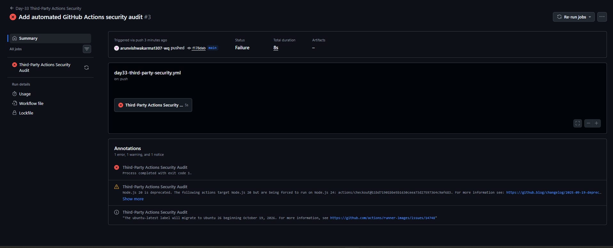
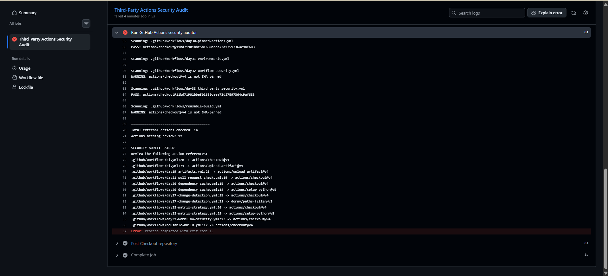
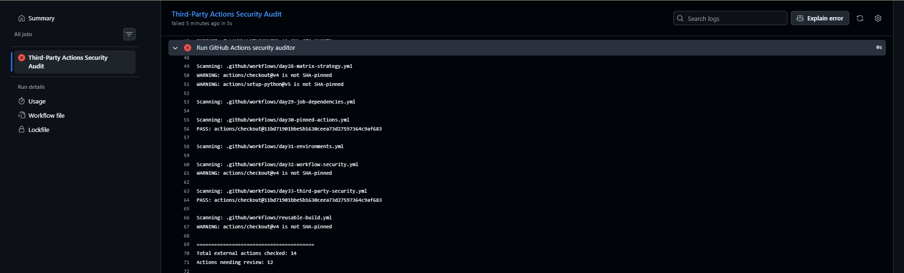

# Day-33: Third-Party Actions & Supply Chain Security

## Objective
To build a Python-based security auditor that checks whether external GitHub Actions are pinned to full 40-character commit SHAs.

## What I Learned
- Third-party GitHub Actions security
- Version tags vs full commit SHA
- Python workflow scanning
- Detecting unpinned Actions
- Automating security audits with GitHub Actions
- Workflow permissions using contents: read

## Practical Implementation

### 1. Python Security Auditor
Created `scripts/check_action_pinning.py`.

The script:
- Scans `.github/workflows/` files.
- Finds external `uses:` references.
- Checks for full 40-character SHA references.
- Reports unpinned Actions.
- Returns exit code 1 when review is required.

### 2. GitHub Actions Workflow
Created `.github/workflows/day33-third-party-security.yml`.

The workflow runs the Python security auditor when manually triggered or when matching repository files are pushed.

### 3. Workflow YAML

    name: Day-33 Third-Party Actions Security

    on:
      workflow_dispatch:
      push:
        paths:
          - "CI-CD/Day-33/**"
          - "scripts/check_action_pinning.py"
          - ".github/workflows/**"

    permissions:
      contents: read

    jobs:
      security-audit:
        name: Third-Party Actions Security Audit
        runs-on: ubuntu-latest

        permissions:
          contents: read

        steps:
          - name: Checkout repository
            uses: actions/checkout@11bd71901bbe5b1630ceea73d27597364c9af683

          - name: Set up Python
            run: |
              python --version

          - name: Run GitHub Actions security auditor
            run: |
              python scripts/check_action_pinning.py

## Audit Results

| Check | Result |
|---|---:|
| External Actions checked | 14 |
| SHA-pinned Actions | 2 |
| Actions needing review | 12 |
| Audit status | FAILED |

The audit intentionally failed because 12 external Action references were not pinned to full commit SHAs.

## Screenshots

### 1. Workflow Run History

[View Screenshot 1](Screenshots/01-day33-workflow-run.png)

### 2. Security Audit Findings

[View Screenshot 2](Screenshots/02-day33-security-audit-findings.png)

### 3. SHA-Pinned Actions

[View Screenshot 3](Screenshots/03-day33-sha-pinned-actions.png)

## Files

- [Security Audit Workflow](https://github.com/arunvishwakarma1307-wq/cloud-engineering-journey/blob/main/.github/workflows/day33-third-party-security.yml)
- [Python Security Auditor](https://github.com/arunvishwakarma1307-wq/cloud-engineering-journey/blob/main/scripts/check_action_pinning.py)

## Limitations

This is a basic line-based checker. It checks SHA reference format but does not verify commit authenticity, publisher identity, or action source code. It may not detect every YAML structure.

## Conclusion

Successfully built an automated Python-based GitHub Actions security auditor. It scanned 14 external Action references, identified 12 references requiring review, and confirmed 2 SHA-pinned references. The failed audit demonstrated automatic security finding detection.