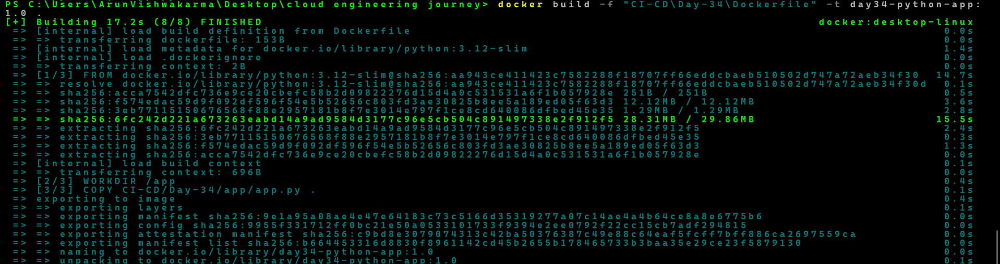
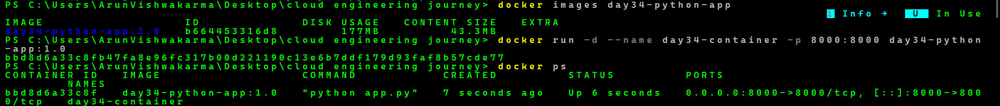
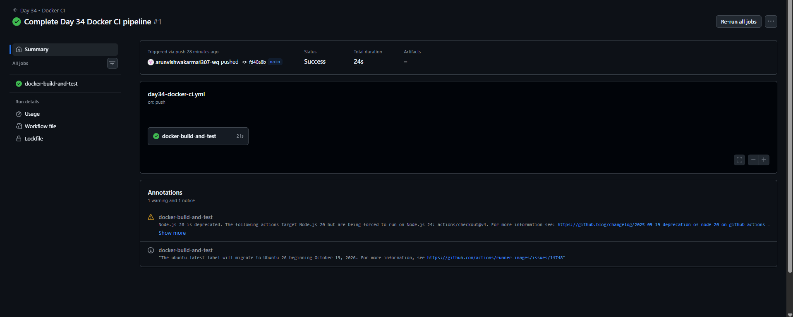

# Day-34: Docker Integration with GitHub Actions

## Overview
In Day-34, I learned how to containerize a Python application using Docker and automate Docker image building and application testing using GitHub Actions.

## Objectives
- Understand Docker images and containers.
- Create a Python application.
- Write a Dockerfile.
- Build a custom Docker image.
- Run a Docker container.
- Test the application using an HTTP request.
- Automate Docker build and testing through GitHub Actions.

## Project Structure

CI-CD/
└── Day-34/
    ├── app/
    │   └── app.py
    ├── Screenshots/
    │   ├── 01-day34-docker-image-build.png
    │   ├── 02-day34-container-running.png
    │   └── 03-day34-github-actions-success.png
    ├── Dockerfile
    └── README.md

## Technologies Used
- Docker
- Python 3.12
- GitHub Actions
- PowerShell
- Git and GitHub

## Practical Implementation

### 1. Python Application
Created a simple HTTP server using Python's built-in `http.server` module.

The application listens on port 8000 and returns:

`Day-34 Docker CI/CD Application is Running!`

### 2. Dockerfile
Created a Dockerfile using the Python 3.12 slim base image.

- Set the working directory.
- Copied the Python application into the image.
- Exposed port 8000.
- Configured the application startup command.

### 3. Docker Image Build
Built the Docker image using:

`docker build -f "CI-CD\Day-34\Dockerfile" -t day34-python-app:1.0 .`

### 4. Run Docker Container

`docker run -d --name day34-container -p 8000:8000 day34-python-app:1.0`

Verified the running container using:

`docker ps`

### 5. Application Testing

Tested the application using:

`Invoke-WebRequest http://localhost:8000 -UseBasicParsing`

**Result:** HTTP 200 OK

The application returned the expected response successfully.

### 6. GitHub Actions Docker CI

Created the workflow:

`.github/workflows/day34-docker-ci.yml`

The workflow performs these tasks:

1. Checks out the repository.
2. Builds the Docker image.
3. Runs the Docker container.
4. Tests the application using an HTTP request.
5. Stops and removes the container after testing.

The workflow runs on matching repository changes and can also be started manually using `workflow_dispatch`.

## Screenshots

### 1. Docker Image Build

### 2. Docker Container Running and Application Test

### 3. GitHub Actions Successful Run

## Learning Outcomes

- Learned how Docker images are built from Dockerfiles.
- Understood the difference between Docker images and containers.
- Learned how to run a container with port mapping.
- Tested a containerized Python application.
- Automated Docker build and application testing using GitHub Actions.
- Understood basic CI automation for containerized applications.

## Conclusion

Successfully containerized a Python application using Docker and implemented a GitHub Actions workflow to build, run, and test the application automatically. The CI workflow completed successfully.

## Status

**Completed — Day-34 Docker CI**