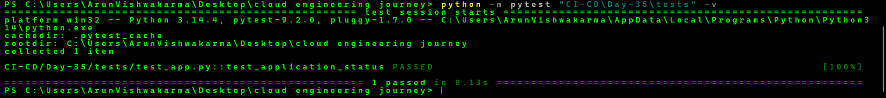
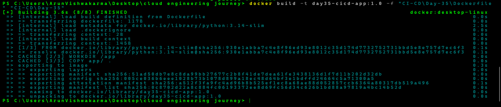
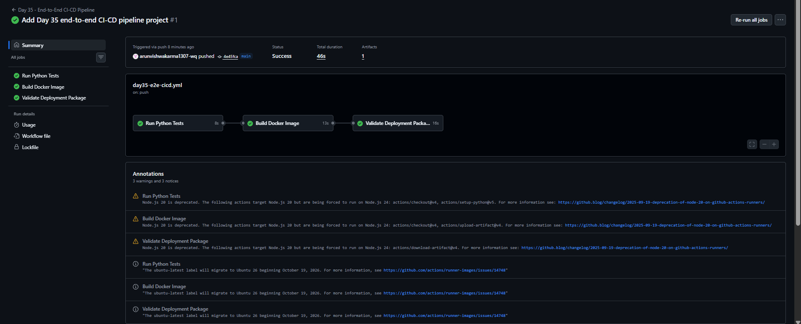

# Day 35 - End-to-End CI/CD Pipeline Project

## Project Overview

This project demonstrates a basic End-to-End CI/CD pipeline using Python, Pytest, Docker, and GitHub Actions.

The pipeline automatically tests the Python application, builds a Docker image, runs the Docker container, creates an application package, uploads it as a GitHub Actions artifact, and validates the downloaded package.

The project is part of my Cloud Engineering and DevOps learning journey.

## Technologies Used

- Python 3.14 – Application development
- Pytest – Automated testing
- Docker – Containerization
- GitHub Actions – CI/CD automation
- Git & GitHub – Version control
- PowerShell – Local testing and commands

## Project Structure

cloud-engineering-journey/
|
|-- .github/
|   |-- workflows/
|       |-- day35-e2e-cicd.yml
|
|-- CI-CD/
|   |-- Day-35/
|       |-- app/
|       |   |-- app.py
|       |
|       |-- tests/
|       |   |-- test_app.py
|       |
|       |-- Screenshots/
|       |   |-- 01-day35-python-tests.png
|       |   |-- 02-day35-docker-build.png
|       |   |-- 03-day35-github-actions-success.png
|       |
|       |-- Dockerfile
|       |-- requirements.txt
|
|-- .gitignore

## CI/CD Pipeline Workflow

The GitHub Actions workflow contains three jobs.

### 1. Run Python Tests

- Checks out the repository.
- Sets up Python 3.14.
- Installs dependencies from requirements.txt.
- Runs automated tests using Pytest.
- Pipeline proceeds only if tests pass.

### 2. Build Docker Image

- Runs after the testing job succeeds.
- Builds a Docker image using the Dockerfile.
- Runs a Docker container to verify the application.
- Creates a ZIP package containing application files.
- Uploads the ZIP package as a GitHub Actions artifact.

### 3. Validate Deployment Package

- Runs after the Docker build job succeeds.
- Downloads the uploaded application artifact.
- Checks that the ZIP package exists and is not empty.
- Lists the package contents to verify its files.

Note: This project demonstrates deployment-package validation. It does not perform an actual production deployment.

## Run the Project Locally

### 1. Install Dependencies

python -m pip install -r "CI-CD\Day-35\requirements.txt"

### 2. Run Python Tests

python -m pytest "CI-CD\Day-35\tests" -v

### 3. Build Docker Image

docker build -t day35-cicd-app:1.0 -f "CI-CD\Day-35\Dockerfile" "CI-CD\Day-35"

### 4. Run Docker Container

docker run --name day35-container day35-cicd-app:1.0

## GitHub Actions Workflow

Workflow file:

[day35-e2e-cicd.yml](../../.github/workflows/day35-e2e-cicd.yml)

The workflow runs automatically when changes are pushed to the Day-35 project files or when the workflow is manually triggered using workflow_dispatch.

## Screenshots

### 1. Python Automated Tests

### 2. Docker Image Build

### 3. GitHub Actions Pipeline Success

## What I Learned

- Understanding the stages of an End-to-End CI/CD pipeline.
- Writing and running automated Python tests using Pytest.
- Building and running Docker containers.
- Automating testing and Docker builds with GitHub Actions.
- Managing dependencies using requirements.txt.
- Creating and uploading GitHub Actions artifacts.
- Validating application packages in a CI/CD workflow.
- Understanding job dependencies using needs.

## Project Status

Completed: Basic End-to-End CI/CD pipeline successfully tested locally and through GitHub Actions.