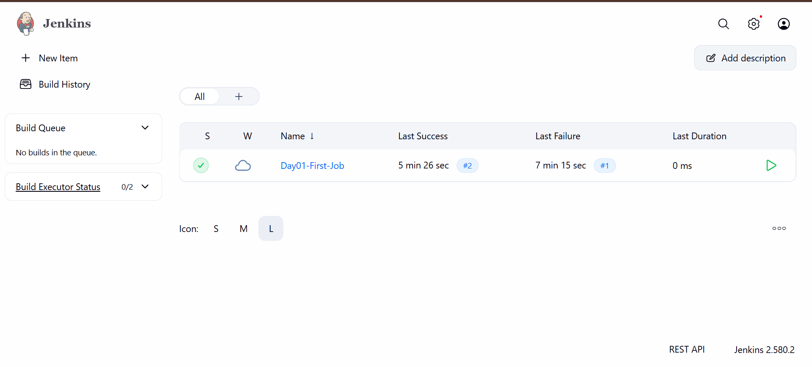
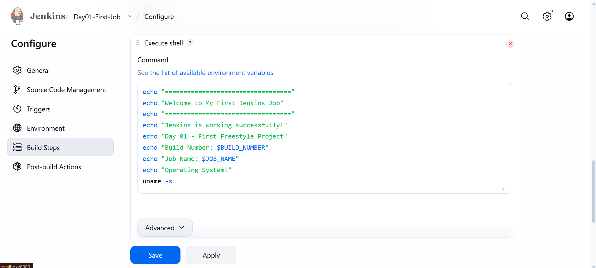
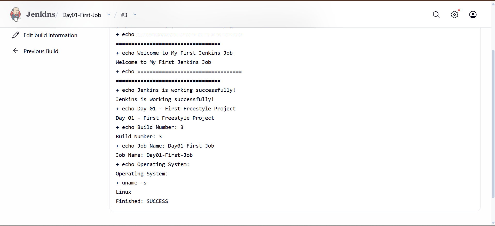

# Jenkins Day-01 — Introduction & First Freestyle Job

## 📌 Overview

Day-01 focused on understanding Jenkins fundamentals, setting up Jenkins using Docker, and creating and executing the first Freestyle Job.

## 🎯 Objectives

- Understand what Jenkins is and why it is used.
- Learn the basics of CI/CD.
- Understand Jenkins Controller and Agent architecture.
- Understand Jobs, Builds, and Pipelines.
- Set up Jenkins using Docker.
- Create and execute a Freestyle Project.
- View build logs through Console Output.

## 🧰 Tools & Technologies

- Jenkins LTS (JDK 21)
- Docker Desktop
- Windows 11
- PowerShell
- Google Chrome

## 📚 Topics Covered

| Topic | Description |
|---|---|
| Jenkins | Automation server for software development tasks. |
| CI | Continuous Integration. |
| CD | Continuous Delivery / Continuous Deployment. |
| Controller | Manages Jenkins jobs and agents. |
| Agent | Executes build and test tasks. |
| Job | A task configured in Jenkins. |
| Build | An execution of a Jenkins job. |
| Pipeline | A sequence of automated steps. |
| Freestyle Project | A job configured through the Jenkins interface. |

## 📸 Practical Screenshots

### 1. Jenkins Dashboard
Jenkins dashboard showing the created job.

### 2. First Freestyle Job Configuration
Freestyle Project configuration with Execute Shell build step.

### 3. Successful Build Output
Console Output showing the build number, job name, Linux operating system, and SUCCESS status.

