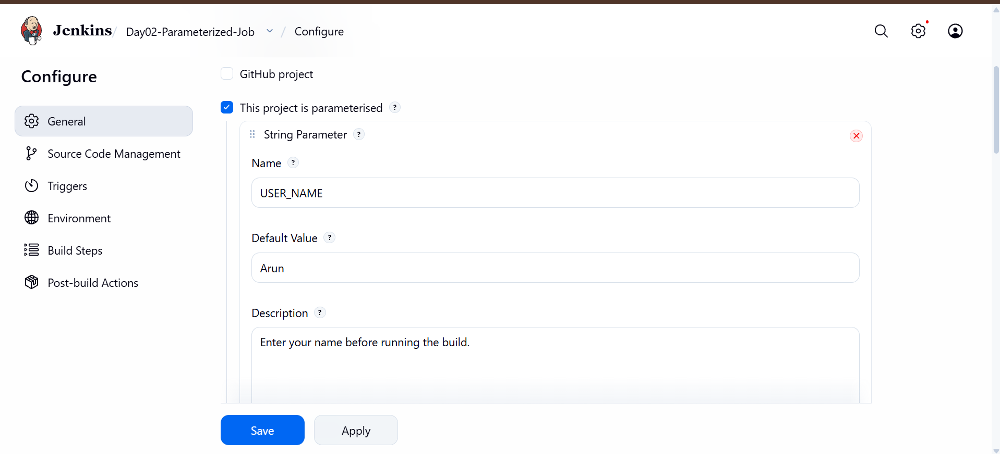
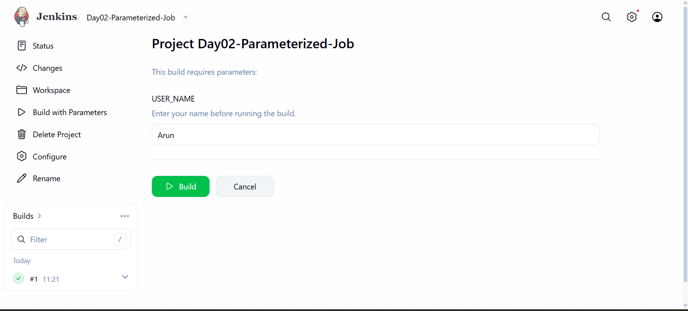
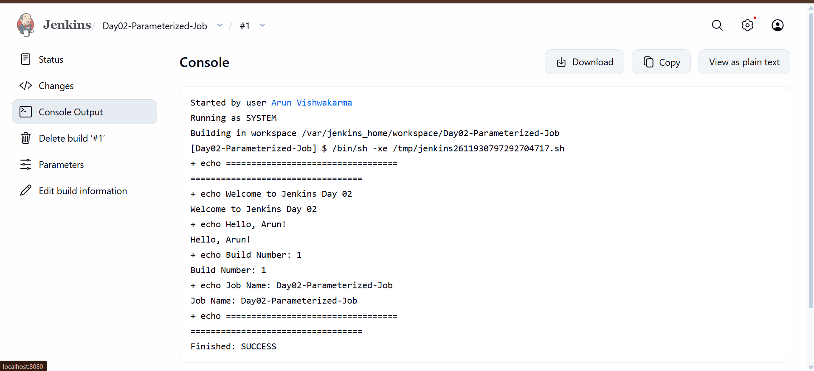

# Day 02 - Jenkins Build Parameters

## Overview
Today, I learned how to use Build Parameters in Jenkins to accept user input before executing a job.

## Objective
To create a Parameterized Freestyle Project that accepts a user's name and displays a personalized greeting in the Jenkins Console Output.

## Tools Used
- Jenkins LTS (JDK 21)
- Docker Desktop
- Windows PowerShell

## Practical Implementation

### 1. Created a Freestyle Project
Created a Jenkins job named:

`Day02-Parameterized-Job`

### 2. Configured Build Parameters

Enabled **This project is parameterized** and added a String Parameter.

| Setting | Value |
|---|---|
| Parameter Type | String Parameter |
| Name | USER_NAME |
| Default Value | Arun |
| Description | Enter your name before running the build. |

### 3. Added Shell Script

```bash
echo "=================================="
echo "Welcome to Jenkins Day 02"
echo "Hello, $USER_NAME!"
echo "Build Number: $BUILD_NUMBER"
echo "Job Name: $JOB_NAME"
echo "=================================="
```

### 4. Executed the Build
- Selected Build with Parameters.
- Entered `Arun` as the username.
- Started Build #1.
- Checked the Console Output.

## Console Output

```text
Welcome to Jenkins Day 02
Hello, Arun!
Build Number: 1
Job Name: Day02-Parameterized-Job
Finished: SUCCESS
```

## Screenshots

### 1. Parameter Configuration


### 2. Build with Parameters


### 3. Console Output Success


## What I Learned
- Jenkins Build Parameters
- String Parameters
- Build with Parameters
- Jenkins Environment Variables
- Console Output Verification

## Result

Successfully created and executed a Parameterized Freestyle Project in Jenkins.

**Status: Completed**

