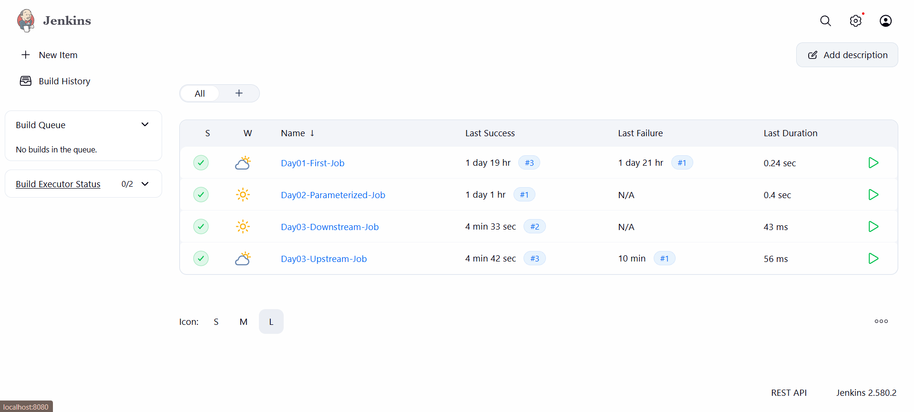
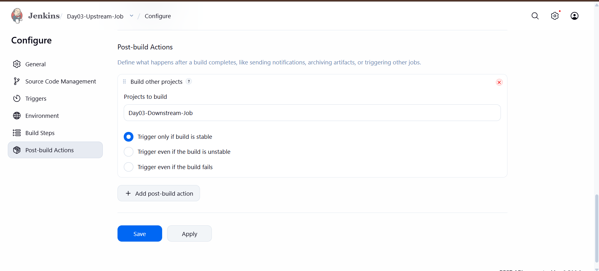
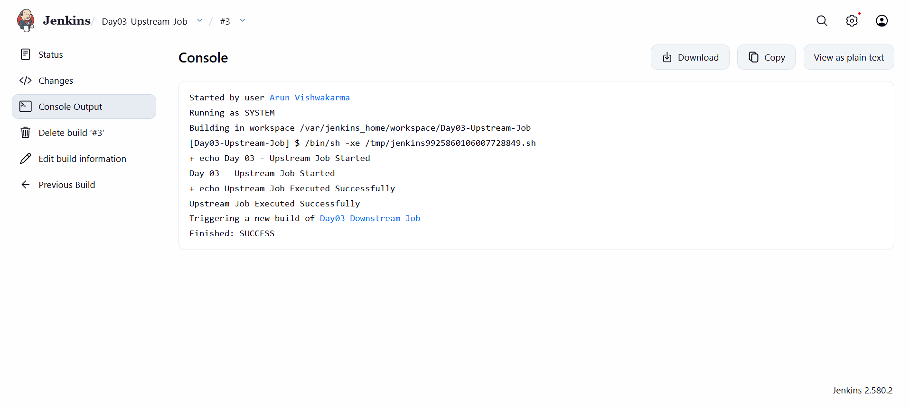
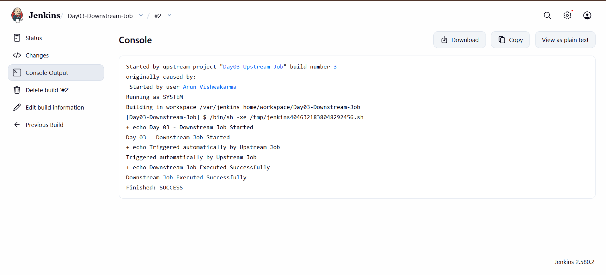

# Day 03 - Jenkins Upstream and Downstream Jobs

## Overview
Today, I learned how to configure Upstream and Downstream Jobs in Jenkins to automate job execution.

## Objective
To create two Freestyle Projects where the Downstream Job is automatically triggered after the successful execution of the Upstream Job.

## Tools Used
- Jenkins LTS (JDK 21)
- Docker Desktop
- Windows PowerShell

## Practical Implementation

### 1. Created Upstream Job

Created a Jenkins Freestyle Project named:

`Day03-Upstream-Job`

Added an Execute shell build step.

### 2. Created Downstream Job

Created another Jenkins Freestyle Project named:

`Day03-Downstream-Job`

Added an Execute shell build step.

### 3. Configured Upstream and Downstream Jobs

Opened the Upstream Job configuration and selected the Post-build Action:

**Build other projects**

| Setting | Value |
|---|---|
| Upstream Job | Day03-Upstream-Job |
| Downstream Job | Day03-Downstream-Job |
| Trigger Condition | Trigger only if build is stable |

### 4. Executed the Upstream Job

- Started the Upstream Job manually.
- Jenkins executed the Upstream build successfully.
- After successful completion, Jenkins automatically triggered the Downstream Job.
- Verified the Downstream Job execution through Console Output.

## Console Output

### Upstream Job

    Day 03 - Upstream Job Started
    Upstream Job Executed Successfully
    Finished: SUCCESS

### Downstream Job

    Day 03 - Downstream Job Started
    Triggered automatically by Upstream Job
    Downstream Job Executed Successfully
    Finished: SUCCESS

## Screenshots

### 1. Jenkins Jobs Dashboard

### 2. Upstream Job Configuration

### 3. Upstream Build Success

### 4. Downstream Build Success

## What I Learned

- Jenkins Upstream Jobs
- Jenkins Downstream Jobs
- Freestyle Project Configuration
- Post-build Actions
- Build Other Projects
- Automatic Job Triggering
- Trigger Only If Build Is Stable
- Execute Shell in Linux-based Jenkins Docker Container
- Console Output Verification

## Result

Successfully created and configured two Jenkins Freestyle Projects. The Downstream Job was automatically triggered after the successful execution of the Upstream Job.

**Status: Completed**

---

Cloud Engineering Journey - Day 03