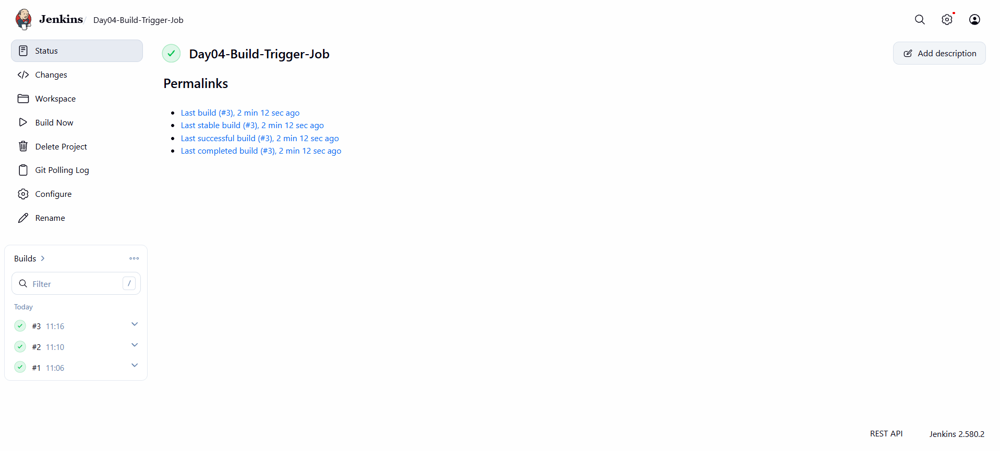
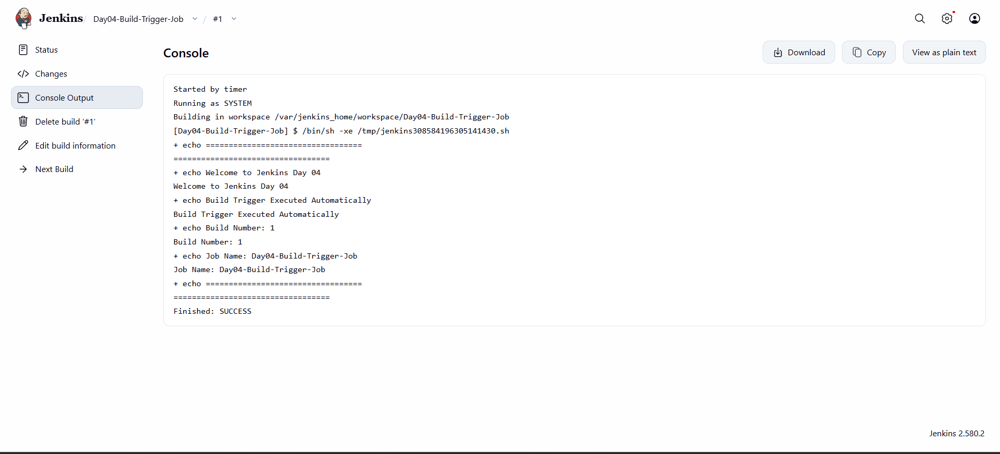
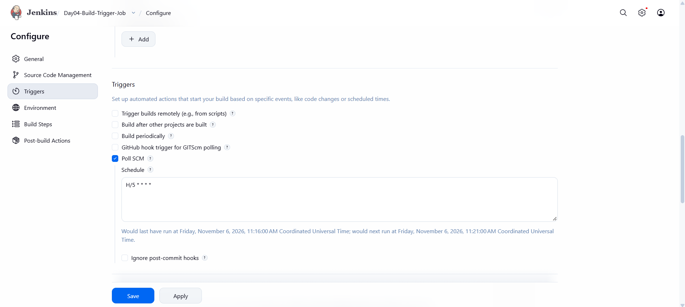
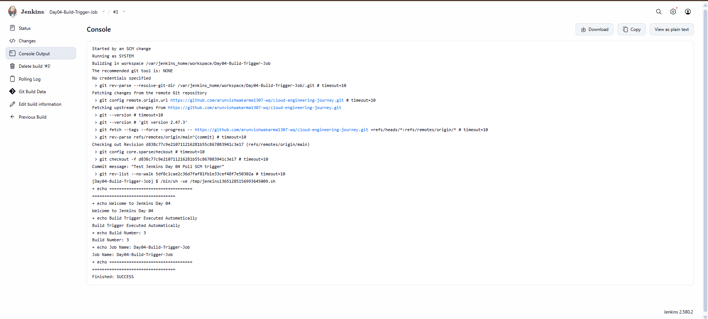

# Day 04 - Jenkins Build Triggers

## Overview
Today, I learned how to configure Build Triggers in Jenkins to automate job execution using scheduled builds and GitHub repository changes.

## Objective
To create a Freestyle Project that automatically executes builds using Build periodically and Poll SCM triggers.

## Tools Used
- Jenkins LTS (JDK 21)
- Docker Desktop
- GitHub
- Git
- Windows PowerShell

## Practical Implementation

### 1. Created a Freestyle Project

Created a Jenkins job named:

`Day04-Build-Trigger-Job`

### 2. Configured Build Periodically

Enabled Build periodically under the Build Triggers section.

| Setting | Value |
|---|---|
| Trigger Type | Build periodically |
| Schedule | H/5 * * * * |
| Execution | Automatically approximately every 5 minutes |

Jenkins automatically triggered the job according to the configured schedule.

### 3. Added Shell Script

Configured an Execute shell build step.

The script displayed:
- Welcome message
- Automatic build trigger message
- Build Number
- Job Name

### 4. Executed Automatic Build

- Saved the job configuration.
- Waited for the scheduled execution.
- Jenkins automatically triggered Build #1.
- Verified the execution through Console Output.
- Confirmed successful completion.

### 5. Configured Poll SCM

Enabled Poll SCM under the Build Triggers section.

| Setting | Value |
|---|---|
| Trigger Type | Poll SCM |
| Schedule | H/5 * * * * |
| Repository | cloud-engineering-journey |
| Branch | */main |

### 6. Connected GitHub Repository

Connected the following GitHub repository to the Jenkins job:

https://github.com/arunvishwakarma1307-wq/cloud-engineering-journey

Configured Git under Source Code Management and selected the main branch.

### 7. Tested Poll SCM

- Created a test file named `poll-scm-test.txt`.
- Committed and pushed the file to GitHub.
- Jenkins checked the repository for changes.
- Jenkins detected the new GitHub commit.
- Automatically triggered Build #3.
- Verified the build through Console Output.

## Console Output

### Build Periodically

Build #1 executed automatically and displayed the Day 04 welcome message.

### Poll SCM

Started by an SCM change

Fetching changes from the remote Git repository

Commit message: "Test Jenkins Day 04 Poll SCM trigger"

Welcome to Jenkins Day 04

Build Trigger Executed Automatically

Build Number: 3

Job Name: Day04-Build-Trigger-Job

Finished: SUCCESS

## Screenshots

### 1. Jenkins Job Dashboard

### 2. Build Periodically Success

### 3. Poll SCM Configuration

### 4. Poll SCM Build Success

## What I Learned

- Jenkins Build Triggers
- Build Periodically
- Poll SCM
- Cron Schedule Syntax
- Automatic Scheduled Builds
- GitHub Repository Integration
- Source Code Management (SCM)
- Git Commit and Push
- Automatic Build Triggering on Repository Changes
- Console Output Verification

## Result

Successfully configured and tested Jenkins Build Triggers using Build periodically and Poll SCM.

Verified automatic scheduled execution and automatic build triggering after a new GitHub commit.

**Status: Completed**

---

Cloud Engineering Journey - Day 04