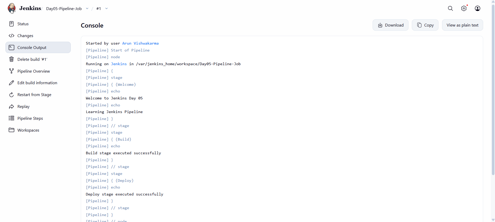
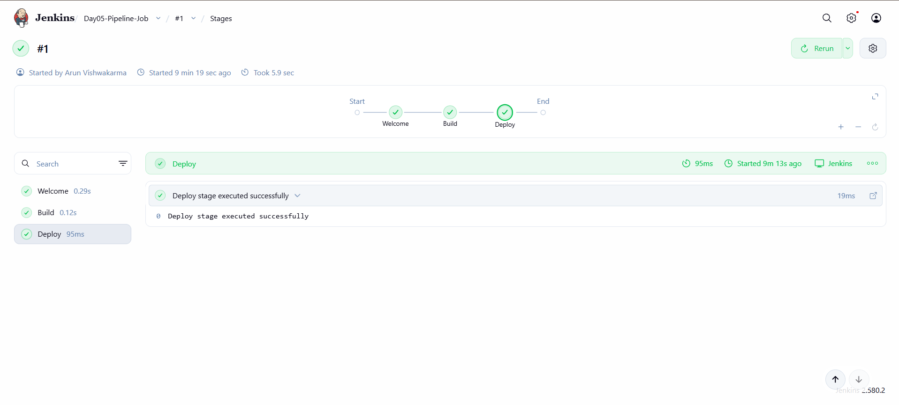
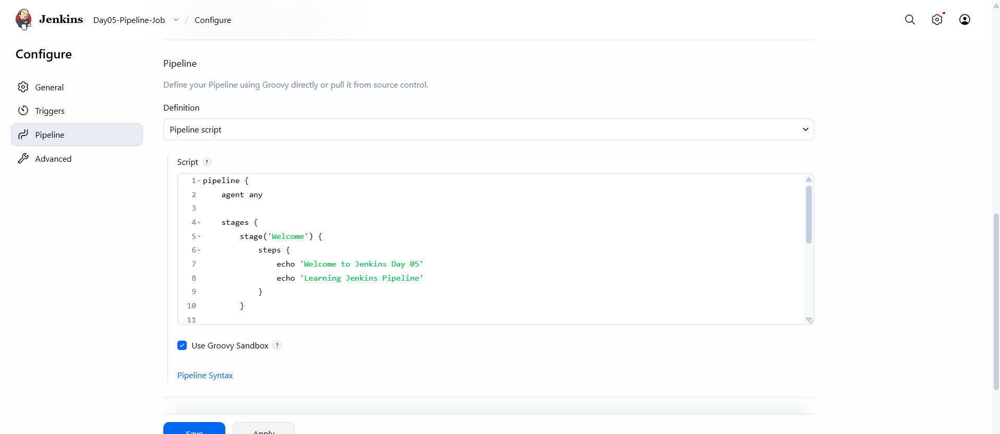
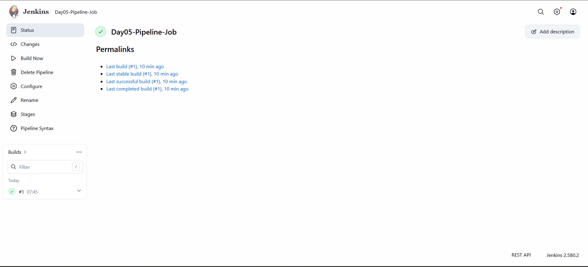

# Day 05 - Jenkins Pipeline Introduction

## Overview

Today, I learned how to create and execute a Jenkins Pipeline using a Declarative Pipeline script.

I created a Pipeline Job with three stages: Welcome, Build, and Deploy.

## Objective

To understand Jenkins Pipeline basics and execute multiple stages through a single Pipeline Job.

## Tools Used

- Jenkins LTS (JDK 21)
- Docker Desktop
- Windows PowerShell
- Groovy (Jenkins Pipeline Script)

## Practical Implementation

### 1. Created a Pipeline Job

Created a new Jenkins Pipeline Job named:

`Day05-Pipeline-Job`

### 2. Configured Declarative Pipeline

Selected Pipeline Script in the Pipeline configuration section and added a Declarative Pipeline script.

The pipeline was configured with three stages:

- Welcome
- Build
- Deploy

### 3. Welcome Stage

Configured the Welcome stage to display:

- Welcome to Jenkins Day 05
- Learning Jenkins Pipeline

### 4. Build Stage

Configured the Build stage to display:

`Build stage executed successfully`

### 5. Deploy Stage

Configured the Deploy stage to display:

`Deploy stage executed successfully`

### 6. Executed Pipeline

- Saved the Pipeline configuration.
- Clicked Build Now.
- Jenkins started Pipeline Build #1.
- All three stages executed successfully.
- Verified execution through Console Output.
- Checked the Pipeline Stage View.

## Pipeline Execution

| Stage | Status |
|---|---|
| Welcome | Success |
| Build | Success |
| Deploy | Success |

**Build Number:** #1

**Execution Time:** 5.9 seconds

**Final Build Status:** SUCCESS

## Console Output

The pipeline displayed the following messages:

- Welcome to Jenkins Day 05
- Learning Jenkins Pipeline
- Build stage executed successfully
- Deploy stage executed successfully

Final Output: `Finished: SUCCESS`

## Screenshots

### 1. Pipeline Console Output

### 2. Pipeline Stage View

### 3. Pipeline Script Configuration

### 4. Pipeline Job Dashboard

## What I Learned

- Introduction to Jenkins Pipeline.
- Declarative Pipeline structure.
- Pipeline Job creation.
- Pipeline stages and steps.
- Execution of multiple stages.
- Pipeline Console Output.
- Pipeline Stage View.
- Build status verification.

## Result

Successfully created and executed a Jenkins Declarative Pipeline with three stages: Welcome, Build, and Deploy.

All stages completed successfully, and the final build status was SUCCESS.

**Status: Completed**

---

Cloud Engineering Journey - Day 05