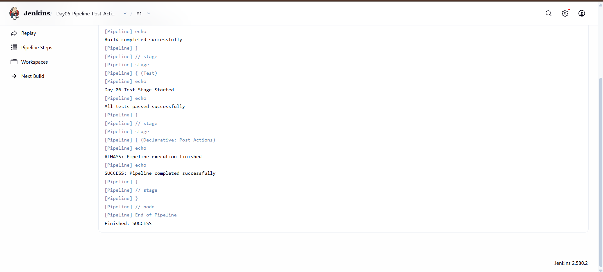
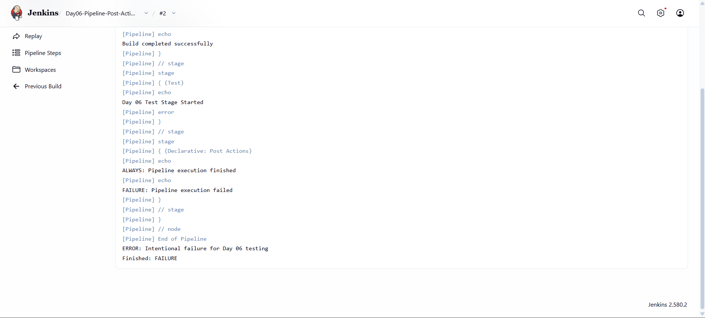
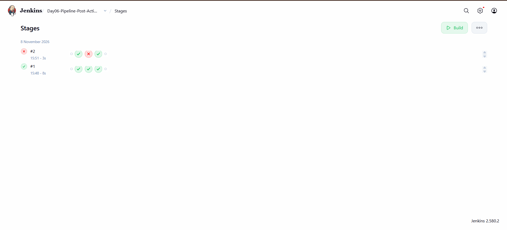
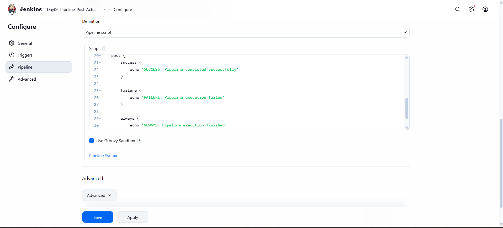

# Day 06 - Jenkins Pipeline Post Actions

## Overview

Today, I learned how to use Post Actions in a Jenkins Declarative Pipeline.

I created a Pipeline Job and tested three post conditions: success, failure, and always.

## Objective

To understand how Jenkins executes post actions based on the final Pipeline build status.

## Tools Used

- Jenkins LTS (JDK 21)
- Docker Desktop
- Windows PowerShell
- Groovy (Jenkins Pipeline Script)

## Practical Implementation

### 1. Created a Pipeline Job

Created a new Jenkins Pipeline Job named:

`Day06-Pipeline-Post-Actions`

### 2. Configured Pipeline Stages

Created two stages:

- Build
- Test

Both stages were configured with echo steps to display execution messages.

### 3. Configured Post Actions

Added three post conditions to the Pipeline:

- `success` - Executes when the Pipeline completes successfully.
- `failure` - Executes when the Pipeline fails.
- `always` - Executes regardless of the Pipeline result.

### 4. Tested Successful Execution

- Executed the Pipeline using Build Now.
- Build #1 completed successfully.
- Both Build and Test stages passed.
- Verified the SUCCESS and ALWAYS messages in Console Output.

**Build #1 Status:** SUCCESS

### 5. Tested Failure Execution

- Added an intentional error inside the Test stage.
- Executed the Pipeline again.
- Build #2 failed during the Test stage.
- Verified the FAILURE and ALWAYS messages in Console Output.

**Build #2 Status:** FAILURE

## Execution Results

| Test | Build Number | Result |
|---|---|---|
| Successful Pipeline | #1 | SUCCESS |
| Intentional Failure | #2 | FAILURE |

## Post Conditions Verified

| Post Condition | Execution |
|---|---|
| success | Executed after successful build |
| failure | Executed after failed build |
| always | Executed after both builds |

## Screenshots

### 1. Successful Pipeline Execution

### 2. Failed Pipeline Execution

### 3. Pipeline Stage View

### 4. Post Actions Script Configuration

## What I Learned

- Jenkins Pipeline Post Actions.
- Success post condition.
- Failure post condition.
- Always post condition.
- Testing successful and failed Pipeline executions.
- Verifying Pipeline results through Console Output and Stage View.

## Result

Successfully created and executed a Jenkins Pipeline to test success, failure, and always post conditions.

Verified that Jenkins executes the appropriate post action according to the Pipeline result.

**Status: Completed**

---

Cloud Engineering Journey - Day 06