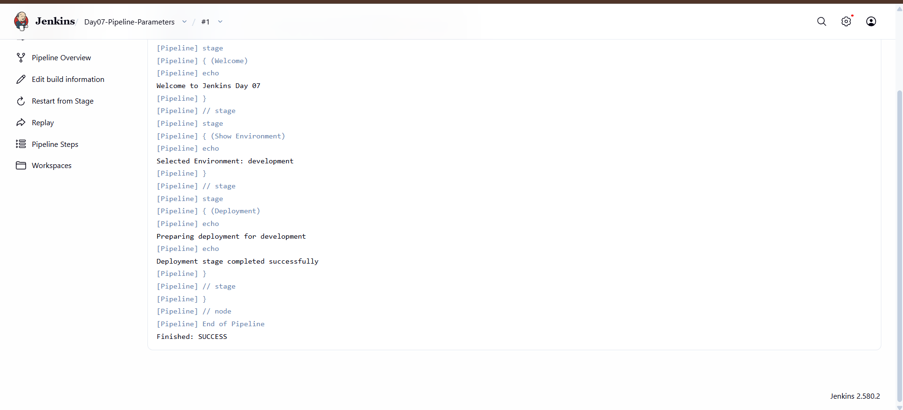
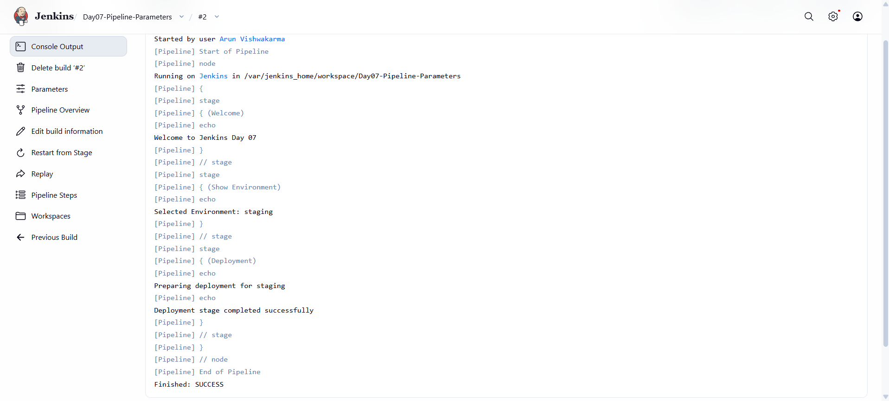
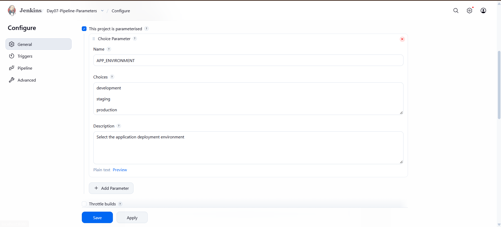
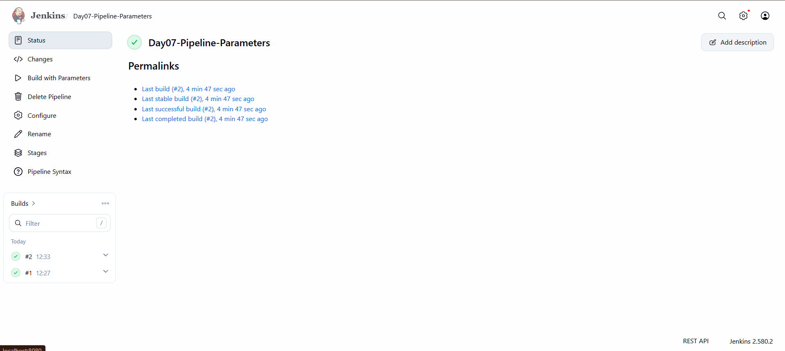

# Day 07 - Jenkins Pipeline Parameters

## Overview

Today, I learned how to use parameters in a Jenkins Declarative Pipeline.

I created a Pipeline Job with a Choice Parameter that allows users to select an application environment before starting a build.

## Objective

To understand how Jenkins Pipeline parameters work and how user-selected values can be accessed during Pipeline execution.

## Tools Used

- Jenkins LTS (JDK 21)
- Docker Desktop
- Windows PowerShell
- Groovy (Jenkins Pipeline Script)

## Practical Implementation

### 1. Created a Pipeline Job

Created a new Jenkins Pipeline Job named:

`Day07-Pipeline-Parameters`

### 2. Configured Choice Parameter

Enabled the `This project is parameterized` option and added a Choice Parameter.

Parameter configuration:

| Field | Value |
|---|---|
| Parameter Type | Choice Parameter |
| Name | APP_ENVIRONMENT |
| Choice 1 | development |
| Choice 2 | staging |
| Choice 3 | production |

### 3. Configured Pipeline Script

Created a Declarative Pipeline with three stages:

- Welcome
- Show Environment
- Deployment

Used the following expression to access the selected parameter:

`params.APP_ENVIRONMENT`

### 4. Tested Development Environment

- Selected `development` from Build with Parameters.
- Started Pipeline Build #1.
- Verified the selected environment in Console Output.
- Build completed successfully.

**Build #1 Status:** SUCCESS

**Selected Environment:** development

### 5. Tested Staging Environment

- Selected `staging` from Build with Parameters.
- Started Pipeline Build #2.
- Verified the selected environment in Console Output.
- Build completed successfully.

**Build #2 Status:** SUCCESS

**Selected Environment:** staging

## Execution Results

| Build Number | Selected Environment | Status |
|---|---|---|
| #1 | development | SUCCESS |
| #2 | staging | SUCCESS |

## Screenshots

### 1. Development Build Console Output

### 2. Staging Build Console Output

### 3. Parameter Configuration

### 4. Pipeline Job Dashboard

## What I Learned

- Jenkins Pipeline Parameters.
- Choice Parameter configuration.
- Build with Parameters.
- Accessing parameter values using `params`.
- Executing the same Pipeline with different inputs.
- Verifying build results through Console Output.
- Managing environment selections in Jenkins.

## Result

Successfully created and executed a parameterized Jenkins Pipeline.

Tested both development and staging environments, and verified that Jenkins used the selected parameter value during Pipeline execution.

No actual application deployment was performed.

**Status: Completed**

---

Cloud Engineering Journey - Day 07