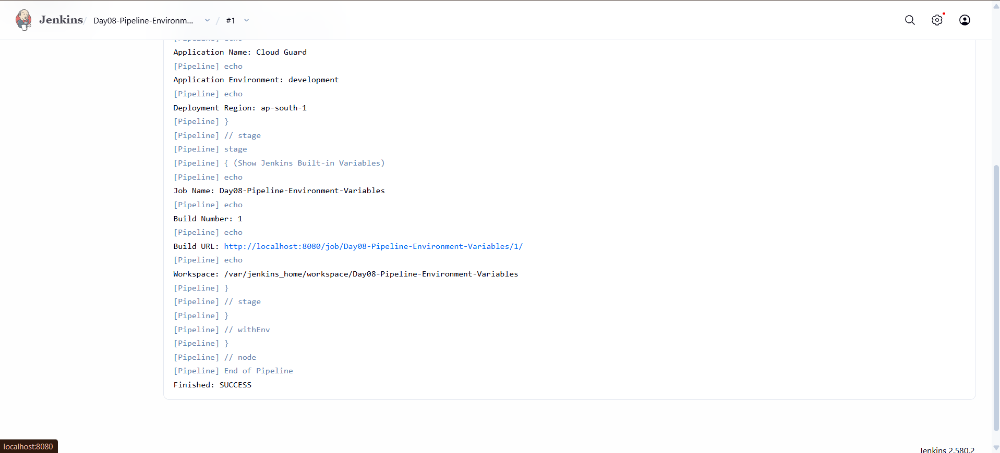
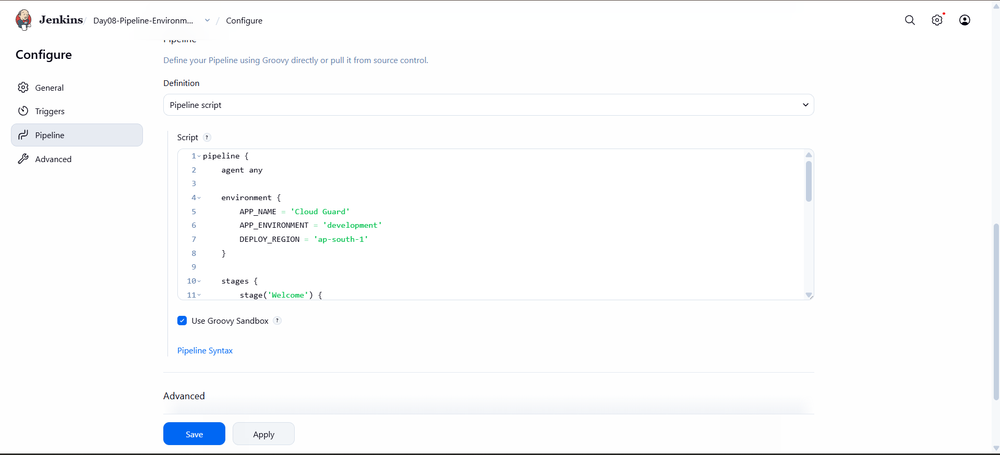
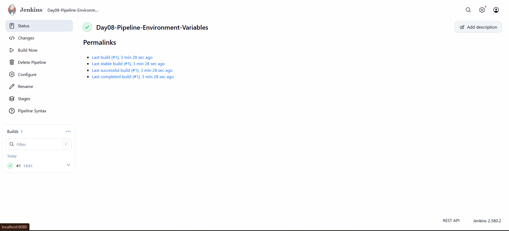

# Day 08 - Jenkins Pipeline Environment Variables

## Overview
This practical demonstrates how to define and access custom environment variables and Jenkins built-in environment variables in a Declarative Pipeline.

## Objective
- Create custom environment variables.
- Access Jenkins built-in environment variables.
- Display variable values in Jenkins Console Output.

## Jenkins Job
`Day08-Pipeline-Environment-Variables`

## Custom Environment Variables

| Variable | Value |
|---|---|
| APP_NAME | Cloud Guard |
| APP_ENVIRONMENT | development |
| DEPLOY_REGION | ap-south-1 |

## Jenkins Built-in Variables

| Variable | Purpose |
|---|---|
| JOB_NAME | Displays the Jenkins job name |
| BUILD_NUMBER | Displays the current build number |
| BUILD_URL | Displays the build URL |
| WORKSPACE | Displays the Jenkins workspace path |

## Practical Execution
- Created a Jenkins Pipeline job.
- Defined custom variables using the `environment` block.
- Accessed variables using the `env` object.
- Printed custom and built-in variable values in Console Output.
- Executed Build #1 successfully.

## Screenshots

### 1. Environment Variables Console Output

### 2. Pipeline Environment Configuration

### 3. Pipeline Job Dashboard

## Result
Successfully executed a Jenkins Declarative Pipeline and verified custom and built-in environment variable values through Console Output.

**Build Status:** SUCCESS