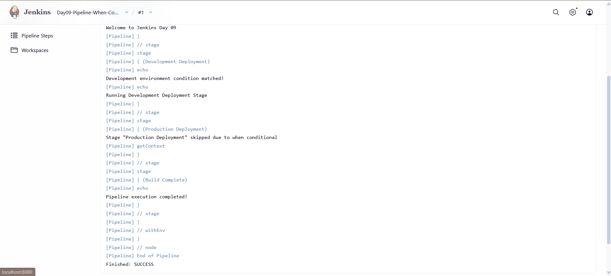
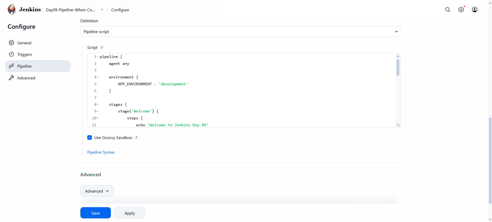
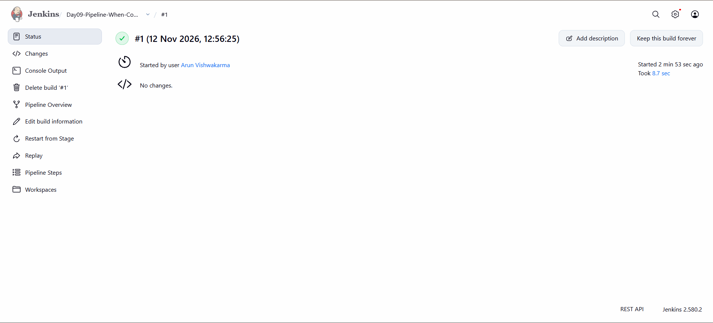

# Day 09 - Jenkins Pipeline when Conditions

## Overview
This practical demonstrates how to use the `when` condition in a Jenkins Declarative Pipeline to control stage execution based on environment variable values.

## Objective
- Understand Jenkins Pipeline `when` conditions.
- Execute stages based on environment variable values.
- Skip stages when conditions do not match.
- Verify conditional stage execution through Console Output.

## Jenkins Job
`Day09-Pipeline-When-Conditions`

## Environment Configuration

| Variable | Value |
|---|---|
| APP_ENVIRONMENT | development |

## Practical Execution

Created a Declarative Pipeline with four stages:

1. **Welcome** - Displays the Day 09 welcome message.
2. **Development Deployment** - Executes when APP_ENVIRONMENT is development.
3. **Production Deployment** - Skips when APP_ENVIRONMENT is not production.
4. **Build Complete** - Displays the pipeline completion message.

## Execution Result

| Stage | Result |
|---|---|
| Welcome | SUCCESS |
| Development Deployment | EXECUTED |
| Production Deployment | SKIPPED |
| Build Complete | SUCCESS |

## Screenshots

### 1. Pipeline Console Output

### 2. Pipeline Configuration

### 3. Pipeline Job Dashboard

## Result

Successfully implemented Jenkins Declarative Pipeline `when` conditions and verified that stages execute or skip according to the configured environment variable.

**Build Status:** SUCCESS