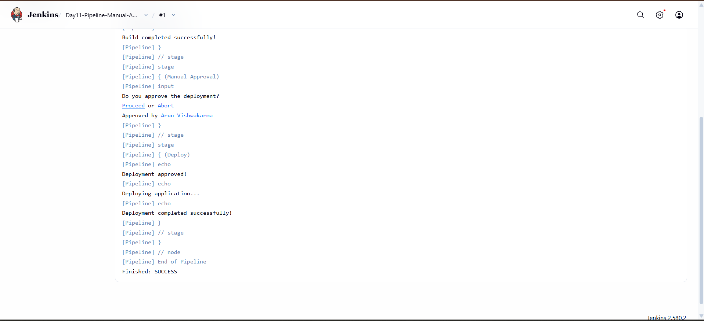
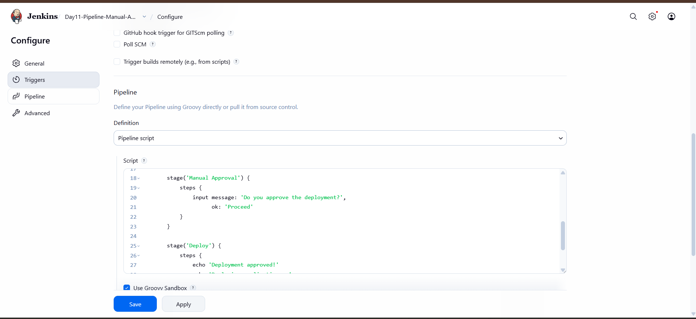
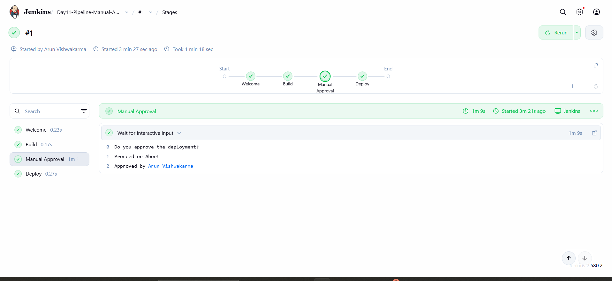

# Day 11 - Jenkins Pipeline Manual Approval

## Overview

This practical demonstrates how to implement manual approval in a Jenkins Declarative Pipeline using the `input` step.

Manual approval allows a user to review and approve a pipeline before the deployment stage continues.

## Objectives

- Understand Jenkins Manual Approval.
- Learn the `input` step.
- Pause pipeline execution for approval.
- Resume pipeline execution after approval.
- Verify deployment through Console Output and Stage View.

## Jenkins Job

`Day11-Pipeline-Manual-Approval`

## Pipeline Stages

| Stage | Description |
|---|---|
| Welcome | Displays the Day 11 welcome message |
| Build | Demonstrates application build completion |
| Manual Approval | Waits for user approval |
| Deploy | Executes after approval is provided |

## Pipeline Execution

1. Created a Jenkins Pipeline job.
2. Configured Welcome and Build stages.
3. Added a Manual Approval stage using the `input` step.
4. Configured the approval button as `Proceed`.
5. Executed Build #1.
6. Jenkins paused and waited for manual approval.
7. Clicked Proceed to continue pipeline execution.
8. Verified that the Deploy stage completed successfully.

## Screenshots

### 1. Manual Approval Console Output

### 2. Pipeline Manual Approval Configuration

### 3. Pipeline Job Dashboard

## Result

Successfully implemented and tested Jenkins Pipeline Manual Approval using the `input` step.

The pipeline waited for manual approval before executing the Deploy stage.

**Build Status:** SUCCESS

**Important Note:** This practical demonstrates manual approval and deployment flow using Jenkins `echo` statements. No actual application was deployed.