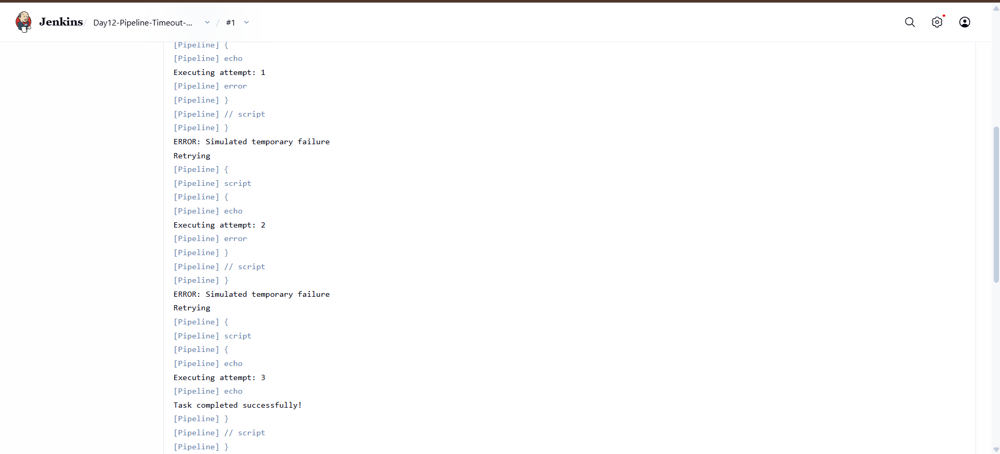
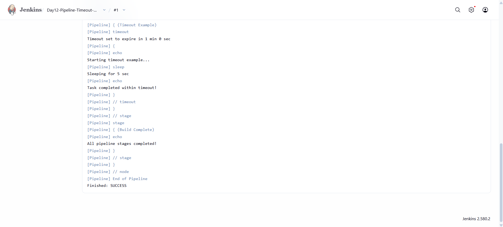
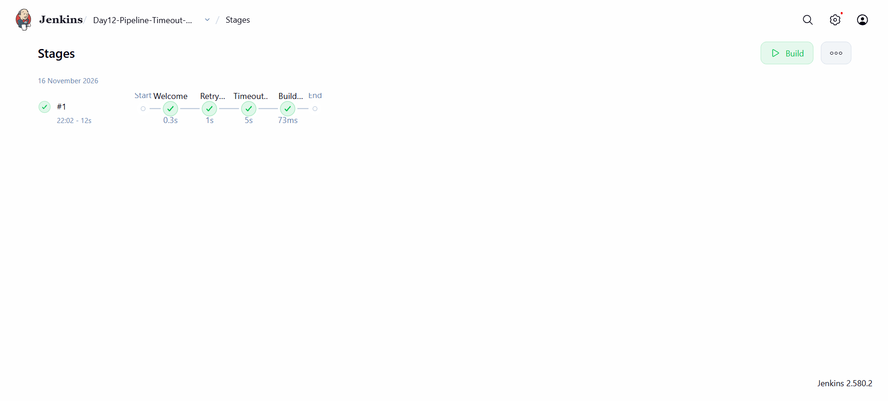

# Day 12 - Jenkins Pipeline Timeout and Retry

## Overview

This practical demonstrates how to use Jenkins Pipeline `retry` and `timeout` features in a Declarative Pipeline.

These features help manage temporary failures and prevent pipeline tasks from running indefinitely.

## Objectives

- Understand Jenkins Retry functionality.
- Learn how to use the `retry` step.
- Understand Jenkins Timeout functionality.
- Learn how to use the `timeout` step.
- Handle simulated failures automatically.
- Verify successful pipeline execution.

## Jenkins Job

`Day12-Pipeline-Timeout-Retry`

## Pipeline Stages

| Stage | Description |
|---|---|
| Welcome | Displays the Day 12 welcome message |
| Retry Example | Retries a task after temporary failures |
| Timeout Example | Executes a task within a specified time limit |
| Build Complete | Displays the final completion message |

## Retry Execution

- Configured a maximum of 3 attempts using `retry(3)`.
- First attempt generated a simulated failure.
- Second attempt generated a simulated failure.
- Third attempt completed successfully.

## Timeout Execution

- Configured a timeout of 1 minute.
- Executed a task with a 5-second sleep.
- Task completed within the configured timeout.

## Pipeline Execution

1. Created a Jenkins Pipeline job.
2. Configured Retry and Timeout examples.
3. Executed Build #1.
4. Verified automatic retries after simulated failures.
5. Verified successful execution on the third attempt.
6. Verified the Timeout stage completed within the configured time.
7. Confirmed the final build status was SUCCESS.

## Screenshots

### 1. Retry Execution Console Output

### 2. Timeout Execution Console Output

### 3. Pipeline Job Dashboard

## Result

Successfully implemented and tested Jenkins Pipeline Retry and Timeout functionality.

**Build Status:** SUCCESS

**Important Note:** The retry practical used simulated failures through Jenkins `error()` statements. The timeout practical completed a 5-second task within a 1-minute limit. No actual application build or deployment was performed.