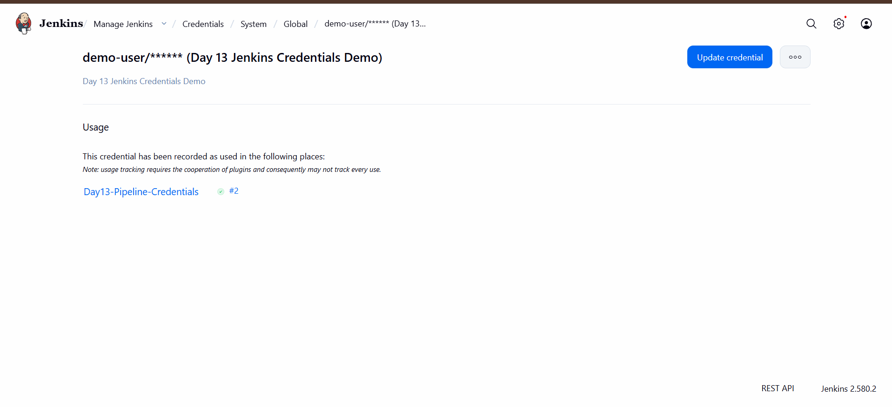
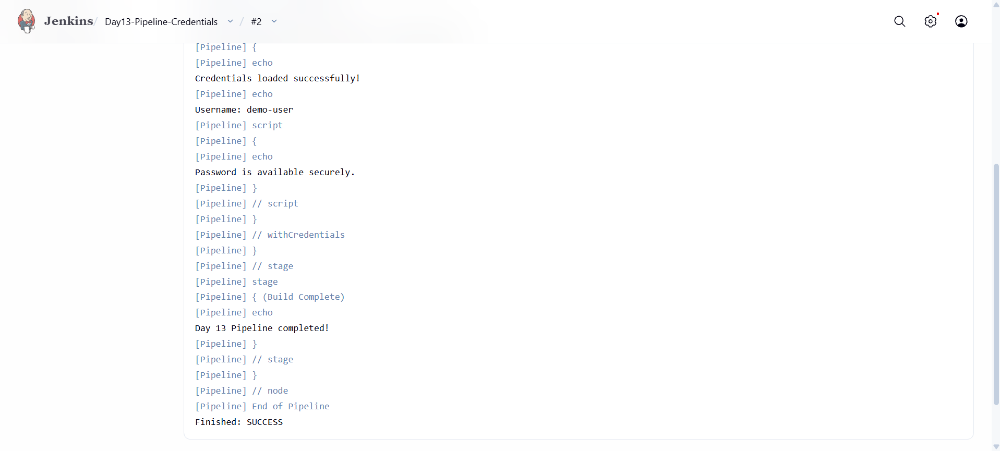
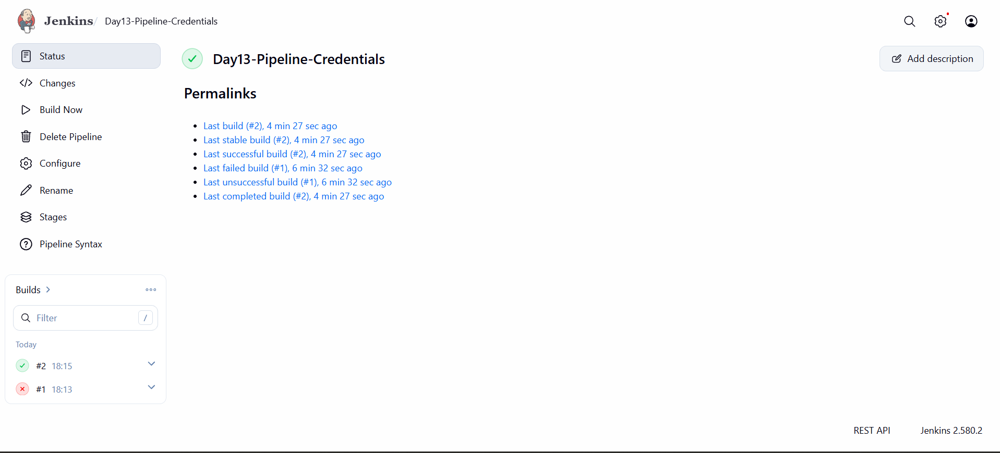

# Day 13 - Jenkins Credentials Management

## Overview

This practical demonstrates how to securely store and use credentials in Jenkins Pipeline.

Jenkins Credentials Manager allows sensitive information such as usernames and passwords to be stored securely and accessed when required.

## Objectives

- Understand Jenkins Credentials Management.
- Create Username with Password credentials.
- Store credentials securely in Jenkins.
- Access credentials using `withCredentials`.
- Use credential variables inside a Pipeline.
- Avoid exposing passwords in console output.

## Jenkins Job

`Day13-Pipeline-Credentials`

## Credential Configuration

| Field | Value |
|---|---|
| Kind | Username with password |
| Scope | Global |
| Username | demo-user |
| Credential ID | jenkins-demo-credential |
| Description | Day 13 Jenkins Credentials Demo |

**Note:** A dummy username and password were used for this practical.

## Pipeline Stages

| Stage | Description |
|---|---|
| Welcome | Displays the Day 13 welcome message |
| Use Credentials | Loads stored credentials using `withCredentials` |
| Build Complete | Displays the final completion message |

## Credentials Usage

Used Jenkins `withCredentials` to access the stored username and password.

- `credentialsId`: Identifies the stored Jenkins credential.
- `DEMO_USERNAME`: Environment variable containing the username.
- `DEMO_PASSWORD`: Environment variable containing the password.

The pipeline verified that the password was available without printing its value.

## Pipeline Execution

1. Opened Jenkins Credentials Manager.
2. Created a Username with Password credential.
3. Created a new Jenkins Pipeline job.
4. Configured the Pipeline using `withCredentials`.
5. Executed the Pipeline.
6. Verified that the username was available.
7. Verified password availability without displaying its value.
8. Confirmed successful Pipeline execution.

## Screenshots

### 1. Credentials Configuration

### 2. Pipeline Console Output

### 3. Pipeline Job Dashboard

## Result

Successfully created and used Jenkins Username with Password credentials inside a Pipeline.

**Build Number:** #2

**Build Status:** SUCCESS

**Important Note:** This practical used dummy credentials for learning purposes. No real GitHub account credentials or external deployment were used.
