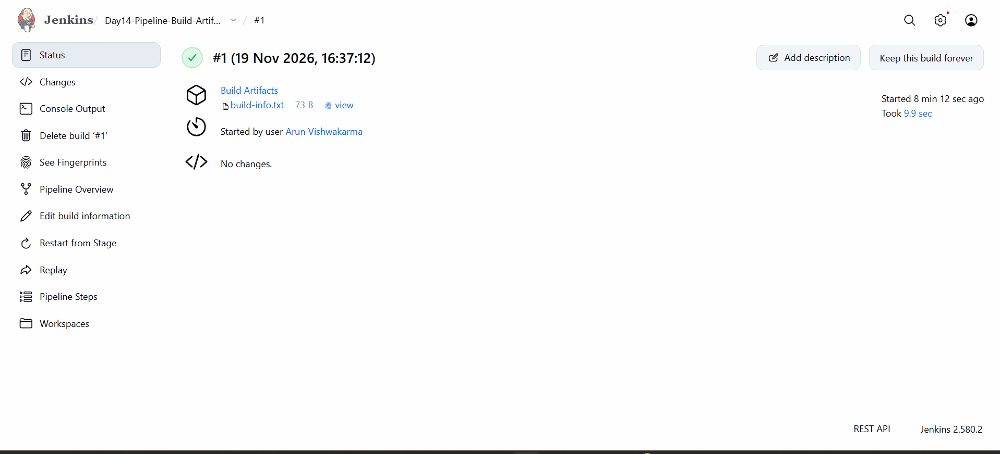
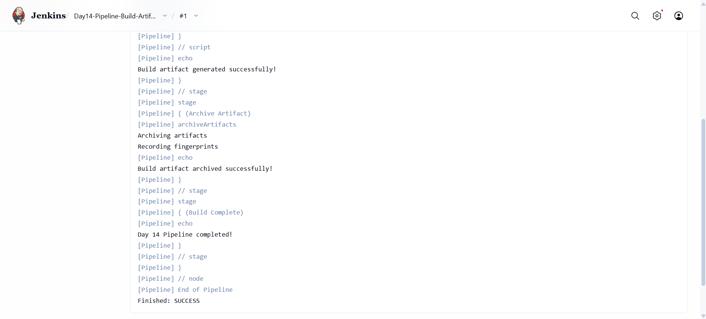
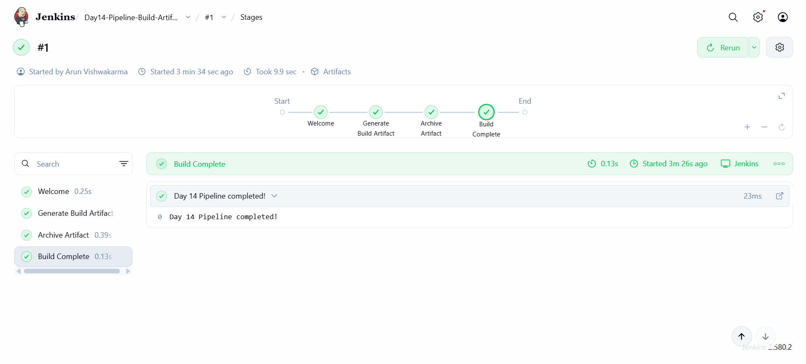

# Day 14 – Jenkins Build Artifacts & Archiving

## Overview
On Day 14 of my Cloud Engineering Journey, I learned how to generate build artifacts and archive them using Jenkins Pipeline.

## Objective
- Understand Jenkins build artifacts.
- Generate a file during pipeline execution.
- Use `archiveArtifacts` to archive generated files.
- Download archived artifacts from a Jenkins build.

## Jenkins Job Details
- **Job Name:** `Day14-Pipeline-Build-Artifacts`
- **Pipeline Type:** Declarative Pipeline
- **Build Number:** #1
- **Build Status:** SUCCESS

## Pipeline Stages

### 1. Welcome
Displays a welcome message for Jenkins Day 14.

### 2. Generate Build Artifact
Uses the `writeFile` Pipeline step to create a file named `build-info.txt` in the Jenkins workspace.

### 3. Archive Artifact
Uses the `archiveArtifacts` step to archive `build-info.txt`.

Fingerprinting is enabled to track the archived artifact.

### 4. Build Complete
Displays the pipeline completion message.

## Generated Artifact

**File:** `build-info.txt`

Content:
- Cloud Engineering Journey - Jenkins Day 14
- Build Artifacts and Archiving

The archived file was successfully downloaded from the Jenkins Build #1 Artifacts section.

## Screenshots

### 1. Archived Artifact

### 2. Pipeline Console Output

### 3. Pipeline Job Dashboard

## Learning Outcome
- Learned what Jenkins build artifacts are.
- Generated a build information file using `writeFile`.
- Archived files using `archiveArtifacts`.
- Enabled artifact fingerprinting.
- Downloaded an archived artifact from Jenkins.

## Result
Successfully completed Jenkins Day 14 – Build Artifacts & Archiving.

**Build #1: SUCCESS**
